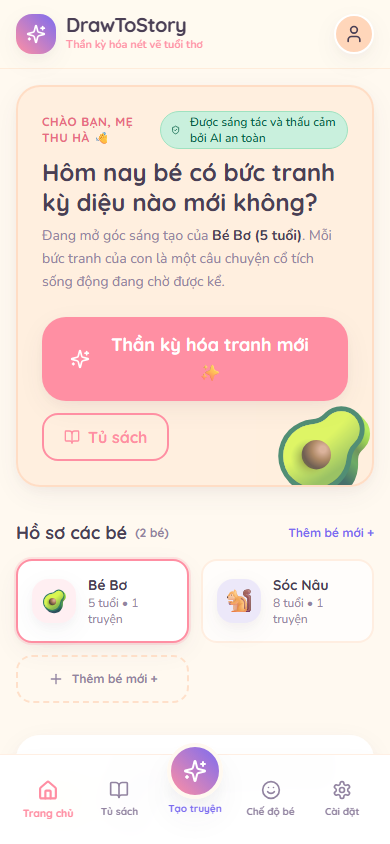
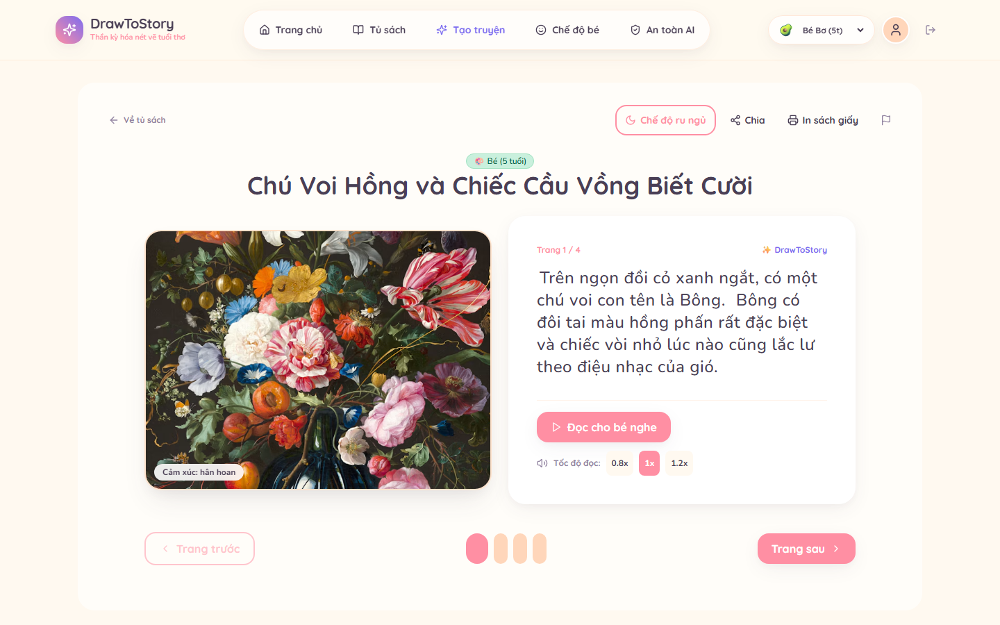
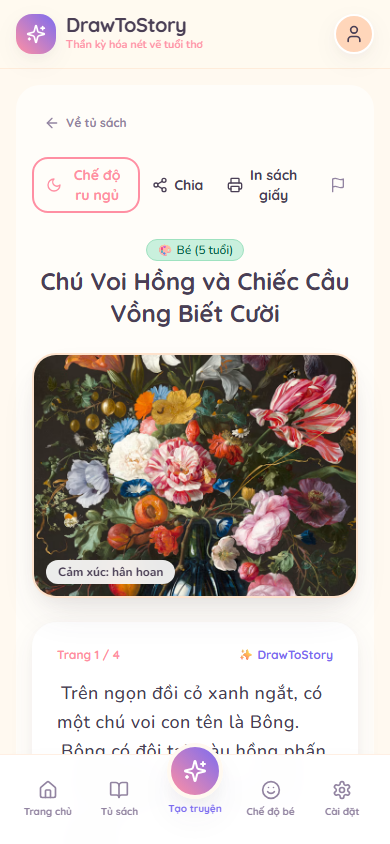
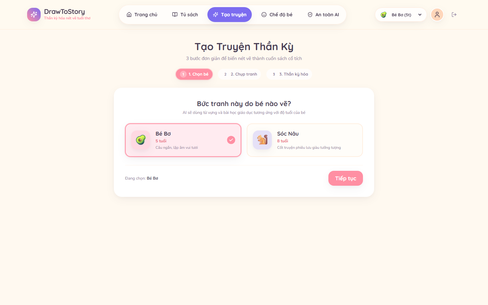
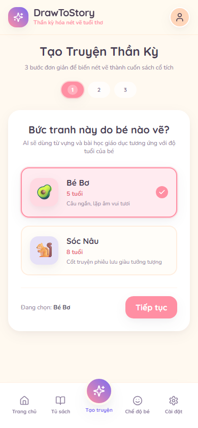
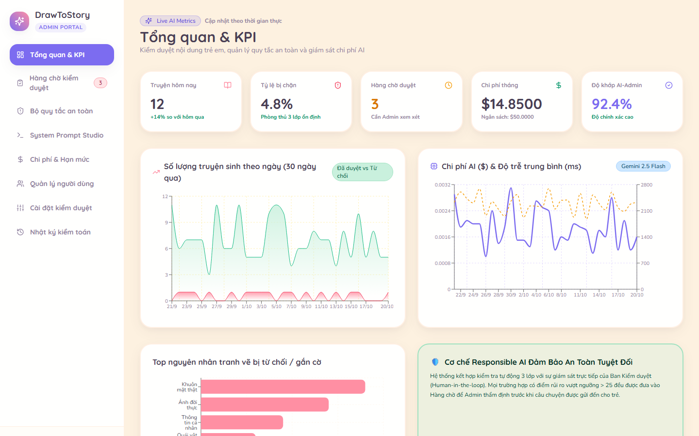
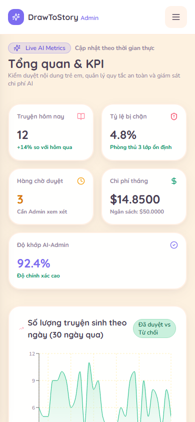
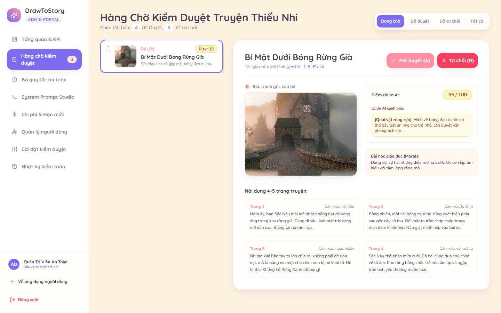
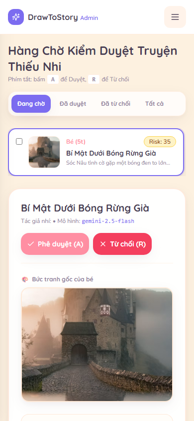

# DrawToStory ✨📖
### Nền Tảng Kể Chuyện Thiếu Nhi Thông Minh từ Tranh Bé Vẽ
**Đồ án môn học:** Lập trình Ứng dụng Trí tuệ Nhân tạo (*AI Based Programming*) — **Trường Đại học Phú Xuân**  
**Giảng viên hướng dẫn:** Bộ môn Công nghệ Thông tin, Đại học Phú Xuân  
**Công nghệ cốt lõi:** React 18, TypeScript (Strict), Vite, Tailwind CSS, Supabase (Postgres, Auth, Storage, Edge Functions), Google Gemini 2.5 Flash, Web Speech API.

---

## 🌟 GIỚI THIỆU TỔNG QUAN

**DrawToStory** là một ứng dụng web cao cấp biến những bức tranh vẽ ngây ngô của trẻ em (từ 2 đến 12 tuổi) thành những cuốn **sách tranh cổ tích 4-5 trang sống động, có giọng đọc truyền cảm, lật trang 3D chân thực và hiệu ứng lia máy hoạt hình (Ken Burns effect)**.

Ứng dụng được thiết kế theo triết lý **Responsible AI (Trách nhiệm Trí tuệ Nhân tạo)**:
1. **AI là trái tim của hệ thống**: Không chỉ là một chatbot văn bản, hệ thống vận hành một **Pipeline 3 Lớp chuyên sâu** kết hợp thị giác máy tính và sáng tác thích ứng theo lứa tuổi.
2. **An toàn thiếu nhi tuyệt đối**: Tự động từ chối ảnh có mặt người thật, ngăn ngừa rò rỉ dữ liệu cá nhân (PII), và thẩm định độc lập điểm rủi ro tâm lý học sinh.
3. **Quản trị viên có vai trò thực thụ**: Hàng đợi kiểm duyệt (Moderation Queue), quản lý bộ quy tắc an toàn động (Safety Rules CRUD), phòng thí nghiệm Prompt Studio (Playground) và giám sát chi phí token thời gian thực.
4. **Trải nghiệm đẳng cấp SaaS**: Hoàn toàn bằng tiếng Việt, thiết kế màu pastel ấm áp chuẩn WCAG AA, hỗ trợ đầy đủ Desktop và Mobile, in ấn thành sách thật (`@media print`).

---

## 📸 BẰNG CHỨNG HÌNH ẢNH GIAO DIỆN (SCREENSHOT SHOWCASE)

> Toàn bộ ảnh chụp được tự động hóa qua Headless Chrome ở 2 kích thước chuẩn: **Desktop (1440px)** và **Mobile (390px)**.

### 1. Bảng Điều Khiển Phụ Huynh (Parent Dashboard)
| Màn hình Desktop (1440px) | Màn hình Mobile (390px) |
| :---: | :---: |
|  |  |

### 2. Trình Đọc Sách 3D & Giọng Đọc Truyền Cảm (Ken Burns + Web Speech TTS)
| Màn hình Desktop (1440px) | Màn hình Mobile (390px) |
| :---: | :---: |
|  |  |

### 3. Wizard Tạo Truyện Thần Kỳ 3 Bước & Phân Tích Canvas
| Màn hình Desktop (1440px) | Màn hình Mobile (390px) |
| :---: | :---: |
|  |  |

### 4. Tổng Quan Điều Hành Admin & Biểu Đồ Chi Phí (Recharts)
| Màn hình Desktop (1440px) | Màn hình Mobile (390px) |
| :---: | :---: |
|  |  |

### 5. Hàng Chờ Kiểm Duyệt Trực Quan (Moderation Queue with Split View & Hotkeys)
| Màn hình Desktop (1440px) | Màn hình Mobile (390px) |
| :---: | :---: |
|  |  |

---

## 🧠 KIẾN TRÚC PIPELINE AI 3 LỚP (TRÁI TIM CỦA HỆ THỐNG)

```
[Ảnh tranh bé vẽ] 
       │
       ▼
┌────────────────────────────────────────────────────────┐
│ LỚP 1: INPUT SAFETY & MULTIMODAL VISION                │
│ • Kiểm tra: Có phải tranh vẽ không? (is_drawing)       │
│ • Chặn ảnh mặt người thật & quét thông tin PII         │
│ • Trích xuất đồ vật, màu sắc, tâm trạng, nhân vật      │
└──────────────────────┬─────────────────────────────────┘
                       │ Dữ liệu ngữ nghĩa an toàn
                       ▼
┌────────────────────────────────────────────────────────┐
│ LỚP 2: SÁNG TÁC THIẾU NHI THÍCH ỨNG ĐỘ TUỔI            │
│ • Ghép động Active System Prompt + Safety Rules        │
│ • Ngôn ngữ thích ứng: Mầm non (2-4), Tiểu học (5-12)   │
│ • Tạo 4-5 trang (30-50 từ/trang), cảm xúc & moral      │
│ • Xác định tọa độ Ken Burns {x, y, zoom} & 3 gợi ý vẽ  │
│ • Kiểm định JSON Schema với Zod + 1x Auto-Retry        │
└──────────────────────┬─────────────────────────────────┘
                       │ Bản thảo câu chuyện
                       ▼
┌────────────────────────────────────────────────────────┐
│ LỚP 3: OUTPUT SAFETY JUDGE (KIỂM DUYỆT ĐỘC LẬP)        │
│ • Phiên LLM độc lập đóng vai Giám định viên Tâm lý     │
│ • Chấm điểm Risk Score (0-100) theo 10 quy tắc an toàn │
│ • Phân luồng: auto_approved | pending_review | rejected│
└────────────────────────────────────────────────────────┘
```

---

## 🛠️ CẤU TRÚC THƯ MỤC DỰ ÁN

```
DoanAIBP/
├── docs/                             # Tài liệu kỹ thuật & kiến trúc hoàn chỉnh
│   ├── 01-NGHIEP-VU.md               # Nghiệp vụ, Persona, Luồng bài toán & RBAC
│   ├── 02-GIAO-DIEN-AI.md            # Đặc tả Pipeline AI 3 lớp & Responsible AI
│   ├── 03-KY-THUAT-FRONTEND.md       # Frontend SPA, Zustand Stores & Trải nghiệm
│   ├── 04-KY-THUAT-ADMIN.md          # Phân hệ Quản trị, Moderation & Database Views
│   ├── ASSUMPTIONS.md                # Toàn bộ giả định kỹ thuật & sản phẩm
│   └── screenshots/                  # 12 bức ảnh kiểm thử 1440px và 390px
├── public/                           # Tài nguyên tĩnh & favicon
├── scripts/                          # Script kiểm thử tự động (take-screenshots.js)
├── src/
│   ├── app/                          # Routing, Route Guards (AuthGuard, RoleGuard)
│   ├── components/                   # UI Primitives & Layouts (User & Admin)
│   ├── features/
│   │   ├── admin/                    # 6 màn hình quản trị hoàn chỉnh
│   │   ├── ai/                       # Canvas Compression & Pipeline Progress
│   │   ├── auth/                     # Đăng nhập, Đăng ký, Quên mật khẩu
│   │   ├── reader/                   # 3D Flip, Swipe, TTS, Ken Burns, Ru ngủ
│   │   ├── story/                    # Create Wizard, Thư viện, Chia sẻ
│   │   └── user/                     # Dashboard, Settings, Kid Mode (Cổng phụ huynh)
│   ├── lib/
│   │   ├── i18n/vi.ts                # Từ điển tiếng Việt tập trung 100%
│   │   └── supabase.ts               # Supabase Client khởi tạo
│   ├── stores/                       # Zustand Stores (Auth, Story, Admin, UI)
│   └── types/                        # TypeScript Strict Types
├── supabase/
│   ├── functions/                    # Deno Edge Functions (generate-story, etc.)
│   ├── migrations/001_init.sql       # 13 bảng Postgres, RLS, Views & Triggers
│   └── seed.sql                      # Dữ liệu mẫu 30 ngày, 10 safety rules, admin
├── AI-DECLARATION.md                 # Tuyên bố minh bạch sử dụng AI học thuật
├── tailwind.config.js                # Tokens màu pastel & font Quicksand/Nunito
├── tsconfig.json                     # TypeScript cấu hình Strict
├── vercel.json                       # Cấu hình Deploy SPA Rewrite
└── package.json                      # Danh mục dependencies & scripts
```

---

## 🔑 TÀI KHOẢN TRẢI NGHIỆM DÀNH CHO GIẢNG VIÊN (DEMO CREDENTIALS)

Ứng dụng tích hợp sẵn cơ chế **Reviewer Offline Fallback**: Giảng viên có thể đăng nhập ngay mà không cần kết nối Supabase Cloud:

| Vai trò (Role) | Email | Mật khẩu | Đặc quyền chính |
| :--- | :--- | :--- | :--- |
| **Quản trị viên (Admin)** | `admin@drawtostory.vn` | `Admin@123456` | Toàn quyền kiểm duyệt, chỉnh sửa Prompt Studio, quản lý Safety Rules, xem biểu đồ chi phí token. |
| **Phụ huynh Demo 1** | `me@phuhuynh.vn` | `Parent@123456` | Có 2 bé (Bé Bơ 4 tuổi, Bé Khoai 7 tuổi), 4 truyện tranh mẫu, huy hiệu và streak sáng tạo. |
| **Phụ huynh Demo 2** | `ba@phuhuynh.vn` | `Parent@123456` | Tài khoản gia đình thứ hai để kiểm thử phân quyền độc lập. |

> *Mẹo tiện lợi:* Trên màn hình Đăng nhập (`/login`), có sẵn 3 nút bấm nhanh để điền ngay thông tin tài khoản mẫu chỉ với 1 click!

---

## 🚀 HƯỚNG DẪN CÀI ĐẶT & CHẠY THỰC TẾ

### 1. Yêu cầu môi trường
- **Node.js**: Phiên bản 18.x trở lên.
- **npm** hoặc **pnpm**.

### 2. Cài đặt dependencies
```bash
git clone https://github.com/your-username/drawtostory.git
cd drawtostory
npm install
```

### 3. Cấu hình biến môi trường
Tạo tệp `.env` dựa trên bản mẫu `.env.example`:
```bash
cp .env.example .env
```
Nội dung cơ bản trong `.env`:
```ini
VITE_SUPABASE_URL=https://your-project.supabase.co
VITE_SUPABASE_ANON_KEY=your-anon-key
VITE_GEMINI_MODEL=gemini-2.5-flash
```

### 4. Khởi chạy máy chủ phát triển
```bash
npm run dev
```
Truy cập ứng dụng tại: `http://localhost:5173/`

### 5. Kiểm tra chất lượng mã nguồn & Build sản phẩm
```bash
# Kiểm tra TypeScript nghiêm ngặt (0 lỗi)
npm run typecheck

# Kiểm tra quy chuẩn mã nguồn ESLint
npm run lint

# Đóng gói sản phẩm sản xuất (Vite Build)
npm run build

# Chạy bản thử nghiệm Preview độc lập trên cổng 5199
npm run preview -- --port 5199 --strictPort
```

---

## 🗄️ HƯỚNG DẪN TRIỂN KHAI BACKEND SUPABASE (NẾU DÙNG CLOUD THẬT)

1. **Khởi tạo Database & Chạy Migrations**:
   - Truy cập Supabase SQL Editor.
   - Chạy nội dung tệp `supabase/migrations/001_init.sql` để tạo 13 bảng, RLS Policies, Triggers và 3 Views phân tích.
   - Chạy tệp `supabase/seed.sql` để nạp 10 quy tắc an toàn, badges và dữ liệu 30 ngày.
2. **Triển khai Supabase Edge Functions**:
   ```bash
   supabase functions deploy generate-story --no-verify-jwt
   supabase functions deploy get-shared-story --no-verify-jwt
   supabase functions deploy admin-test-prompt --no-verify-jwt
   supabase secrets set GEMINI_API_KEY=your_google_gemini_api_key
   ```

---

## 📄 GIẤY PHÉP & BẢN QUYỀN

Đồ án được thực hiện phục vụ mục đích học thuật trong khuôn khổ môn học **AI Based Programming** tại **Đại học Phú Xuân**. Toàn bộ mã nguồn và tài liệu tuân theo giấy phép mã nguồn mở MIT License.

