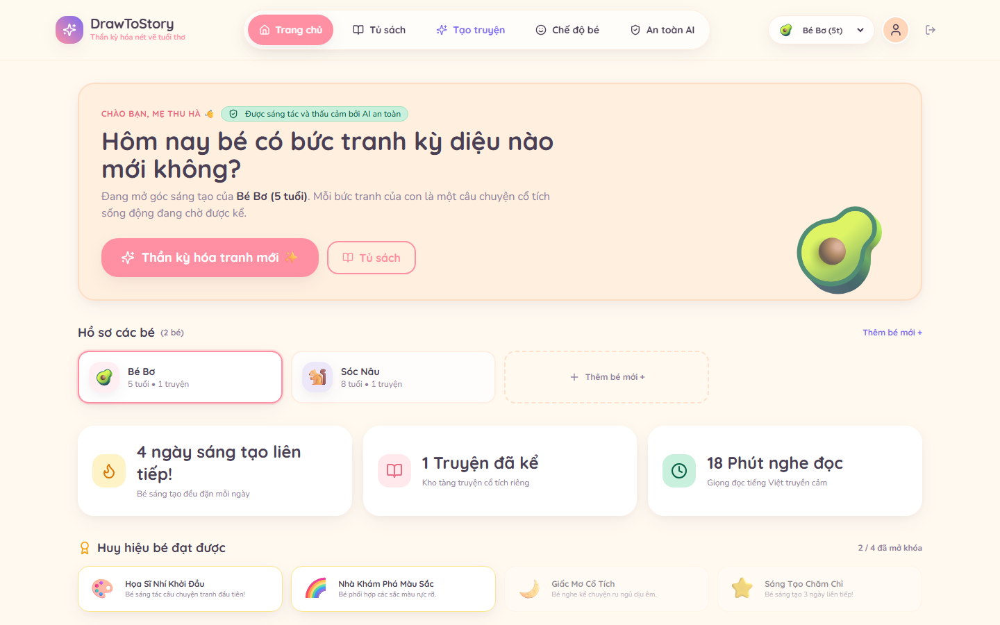
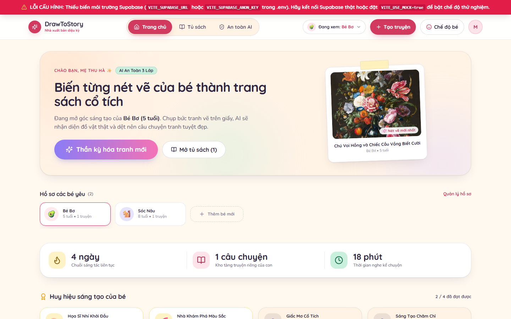
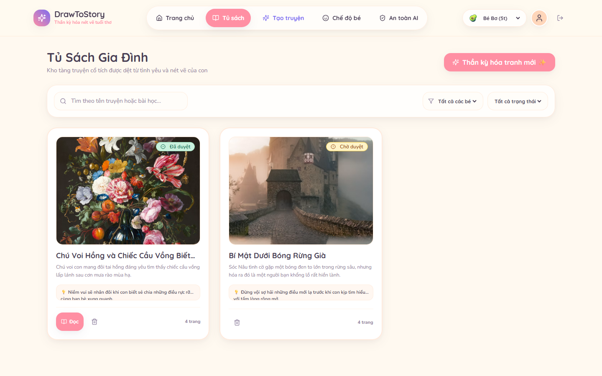
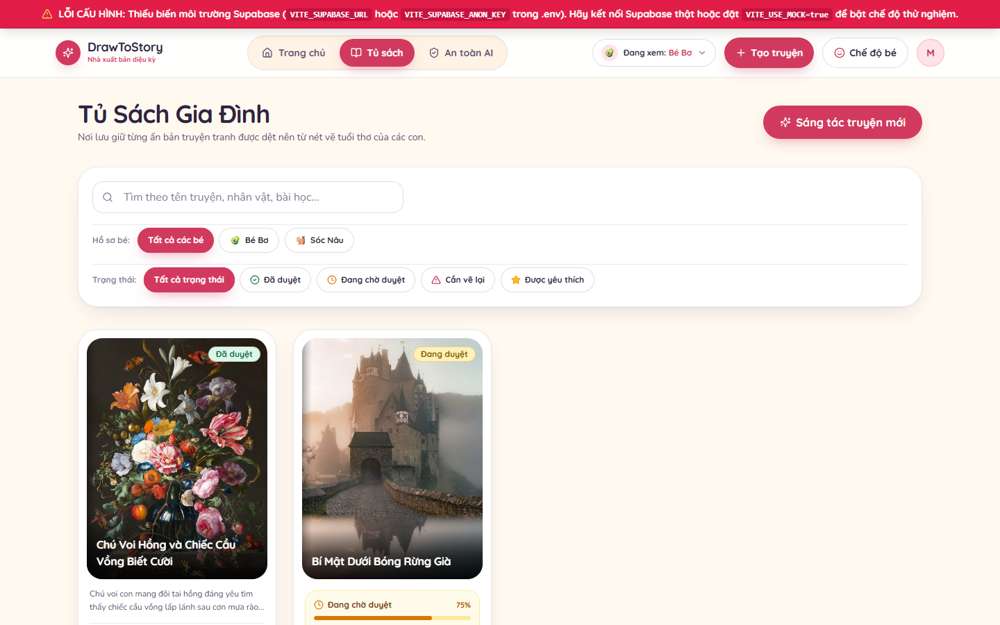
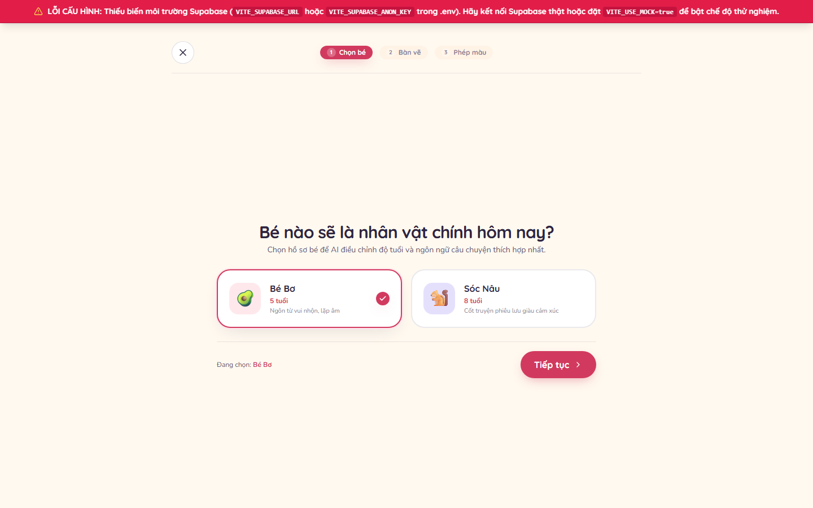
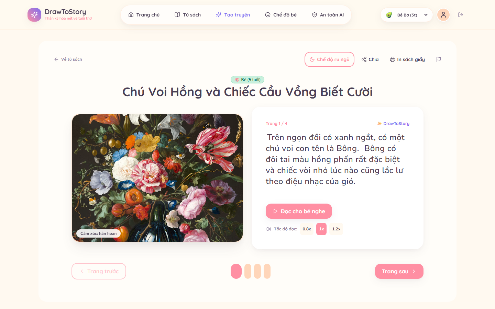
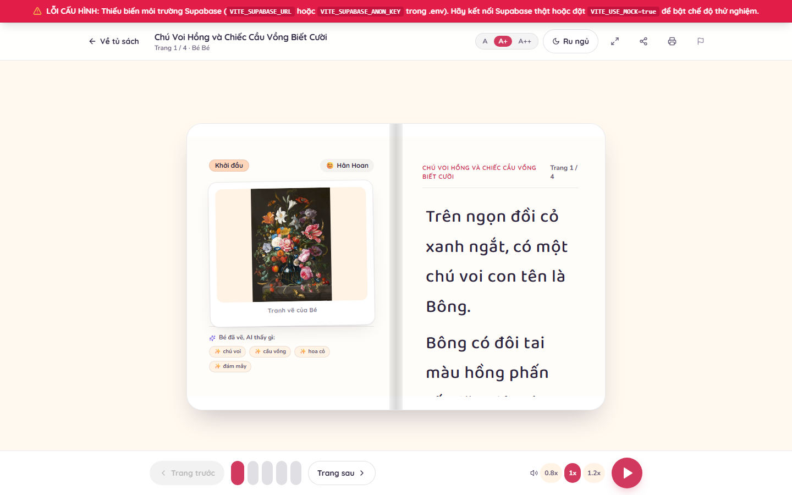
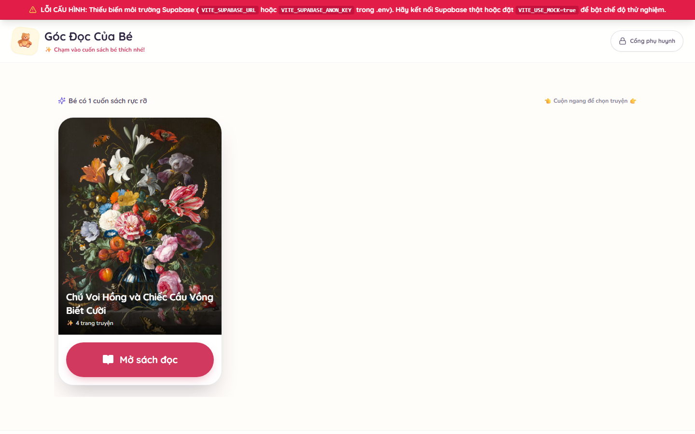
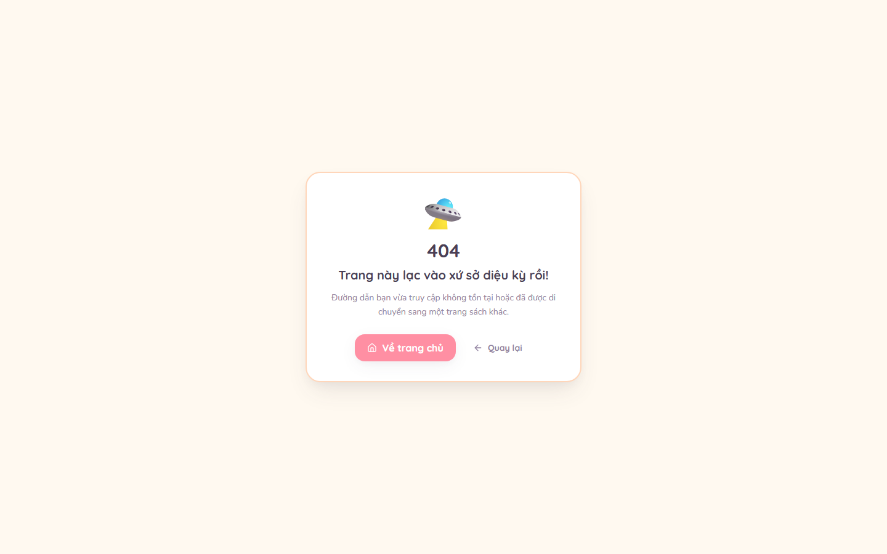
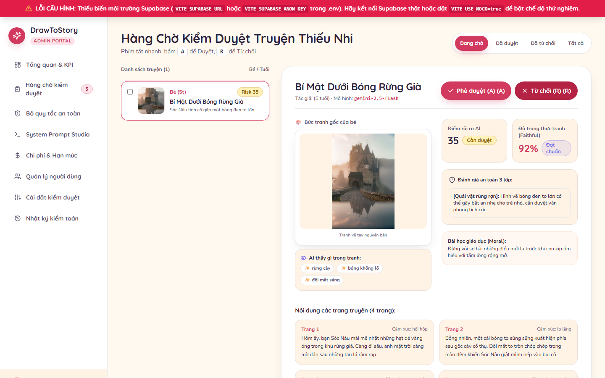

# DrawToStory ✨📖
### Nền Tảng Kể Chuyện Thiếu Nhi Thông Minh từ Tranh Bé Vẽ
**Đồ án môn học:** Lập trình Ứng dụng Trí tuệ Nhân tạo (*AI Based Programming*) — **Trường Đại học Phú Xuân**  
**Giảng viên hướng dẫn:** Bộ môn Công nghệ Thông tin, Đại học Phú Xuân  
**Công nghệ cốt lõi:** React 18, TypeScript (Strict), Vite, Tailwind CSS, Supabase (Postgres, Auth, Storage, Edge Functions), Google Gemini 2.5 Flash, Web Speech API.

---

## 🌟 GIỚI THIỆU TỔNG QUAN

**DrawToStory** là một ứng dụng web cao cấp biến những bức tranh vẽ ngây ngô của trẻ em (từ 2 đến 12 tuổi) thành những cuốn **sách tranh cổ tích 4-5 trang sống động, có giọng đọc truyền cảm, lật trang chân thực (react-pageflip) và hiệu ứng lia máy hoạt hình (Ken Burns effect)**.

Ứng dụng được thiết kế theo triết lý **Modern Storybook** và **Responsible AI**:
1. **Thiết kế Modern Storybook**: Nền kem ấm áp có nhiễu giấy siêu nhẹ (`3.5%`), không có tấm đế be dày, tranh của bé luôn là nhân vật chính đặt trong khung polaroid mềm mại, phông chữ `Baloo 2` chuẩn tiếng Việt và hệ thống màu sắc đạt chuẩn WCAG 2.1 AA.
2. **AI là trái tim của hệ thống**: Vận hành **Pipeline 3 Lớp chuyên sâu** kết hợp thị giác máy tính, phân loại tranh vẽ nghiêm ngặt (`child_drawing`), bám sát vật thể tranh (`grounded_objects`) và chấm điểm trung thực (`faithfulness_score`).
3. **An toàn thiếu nhi tuyệt đối**: Tự động từ chối ảnh có mặt người thật, ảnh chụp đời thường, logo đồ họa hoặc ảnh chụp màn hình văn bản với mã lỗi thân thiện `NOT_A_DRAWING`.
4. **Chế độ Bé cô lập (Kid Mode)**: Toàn màn hình tự động, bẫy lịch sử duyệt web chống thoát tự ý, nút chạm lớn $\ge 72px$, âm thanh vui nhộn (Web Audio API) và cổng phụ huynh bảo mật (giữ 2 giây, đố toán hoặc mã PIN).
5. **Trình đọc sách hoàn hảo (Reading View)**: Đọc từng câu với highlight karaoke, sách lật 2 trang trên máy tính và vuốt ngang trên điện thoại, tranh vẽ hiển thị `object-fit: contain` không bao giờ bị cắt mất viền, chế độ ru ngủ dịu mắt.
6. **Quản trị viên có vai trò thực thụ**: Hàng đợi kiểm duyệt (Moderation Queue với Split View và phím tắt `A`/`R`), bật tắt kiểm tra tranh vẽ nghiêm ngặt, quản lý bộ quy tắc an toàn động và giám sát chi phí token thời gian thực.

---

## 📸 SO SÁNH GIAO DIỆN TRƯỚC VÀ SAU CẢI TIẾN (BEFORE & AFTER)

> Toàn bộ ảnh chụp được tự động hóa qua Headless Chrome ở 2 độ phân giải: **Desktop (1440px)** và **Mobile (390px)** được lưu trữ trong `docs/screenshots/before/` và `docs/screenshots/after/`.

### 1. Bảng Điều Khiển Phụ Huynh (Dashboard)
| Giao diện TRƯỚC (Before) | Giao diện SAU (Modern Storybook After) |
| :---: | :---: |
|  |  |

### 2. Tủ Sách Kệ Gỗ & Thẻ Bìa Sách 3:4 (Library)
| Giao diện TRƯỚC (Before) | Giao diện SAU (Modern Storybook After) |
| :---: | :---: |
|  |  |

### 3. Wizard Tạo Truyện Thần Kỳ (Create Story)
| Giao diện TRƯỚC (Before) | Giao diện SAU (Modern Storybook After) |
| :---: | :---: |
|  |  |

### 4. Trình Đọc Sách Lật Trang & Karaoke TTS (Reading View)
| Giao diện TRƯỚC (Before) | Giao diện SAU (Modern Storybook After) |
| :---: | :---: |
|  |  |

### 5. Góc Đọc Của Bé Cô Lập & Khóa Phụ Huynh (Kid Mode)
| Giao diện TRƯỚC (Before) | Giao diện SAU (Modern Storybook After) |
| :---: | :---: |
|  |  |

### 6. Hàng Chờ Kiểm Duyệt Quản Trị Viên (Admin Moderation Queue)
| Giao diện TRƯỚC (Before) | Giao diện SAU (Modern Storybook After) |
| :---: | :---: |
|  |  |

---

## 🧠 KIẾN TRÚC PIPELINE AI 3 LỚP (RESPONSIBLE AI)

```
[Ảnh tải lên từ phụ huynh]
       │
       ▼
┌────────────────────────────────────────────────────────┐
│ LỚP 1: STRICT DRAWING CLASSIFICATION & INPUT SAFETY    │
│ • Nhận diện thể thức: child_drawing vs photo/logo/text │
│ • Kiểm tra khuôn mặt người lớn & thông tin cá nhân PII │
│ • Từ chối ảnh không phải tranh vẽ: NOT_A_DRAWING       │
│ • Trích xuất đặc trưng thị giác & grounded_objects     │
└────────────────────────────────────────────────────────┘
       │ (Hợp lệ: child_drawing)
       ▼
┌────────────────────────────────────────────────────────┐
│ LỚP 2: VISUAL GROUNDING CREATIVE ENGINE                │
│ • Sáng tác truyện 4-5 trang với font Baloo 2           │
│ • Bắt buộc bám sát grounded_objects từ tranh của bé    │
│ • Kẹp an toàn Ken Burns focus_region (zoom <= 1.35x)   │
│ • Định dạng Zod Schema JSON có cấu trúc                │
└────────────────────────────────────────────────────────┘
       │
       ▼
┌────────────────────────────────────────────────────────┐
│ LỚP 3: FAITHFULNESS SCORING & OUTPUT SAFETY JUDGE      │
│ • Chấm điểm độ trung thực tranh vẽ (faithfulness_score)│
│ • Tự động thử lại (retry) nếu điểm trung thực < 60     │
│ • Chấm điểm rủi ro an toàn tâm lý thiếu nhi (0 - 100)  │
│ • Định tuyến: auto_approved | pending_review | rejected│
└────────────────────────────────────────────────────────┘
```

---

## 🛠️ HƯỚNG DẪN CÀI ĐẶT VÀ CHẠY DỰ ÁN

### 1. Yêu Cầu Môi Trường
- **Node.js**: Phiên bản 18 trở lên (khuyên dùng Node.js 20 LTS).
- **Trình duyệt**: Google Chrome hoặc Microsoft Edge hiện đại.

### 2. Cài Đặt Dependencies
```bash
npm install
```

### 3. Cấu Hình Biến Môi Trường (`.env`)
Tạo file `.env` từ `.env.example`:
```env
VITE_SUPABASE_URL=https://your-project.supabase.co
VITE_SUPABASE_ANON_KEY=your-anon-key
VITE_USE_MOCK=false
```
> **Lưu ý về Mock Data**: Ứng dụng kết nối trực tiếp với cơ sở dữ liệu Supabase thật. Nếu bật `VITE_USE_MOCK=true`, hệ thống sẽ hiển thị biểu ngữ dính cố định **"DỮ LIỆU DEMO"** trên cùng màn hình theo đúng quy chuẩn nghiệm thu.

### 4. Các Lệnh Kiểm Thử & Chạy Ứng Dụng

| Lệnh | Mục đích |
| :--- | :--- |
| `npm run test:pipeline` | Chạy bộ kiểm thử tự động 6 fixtures phân loại tranh vẽ và kiểm tra toggle cài đặt |
| `npm run typecheck` | Kiểm tra toàn bộ mã nguồn TypeScript Strict (`tsc --noEmit`) |
| `npm run lint` | Chạy ESLint kiểm tra cú pháp và quy chuẩn mã nguồn |
| `npm run build` | Tự động kiểm tra độ tương phản WCAG 2.1 AA (19 cặp màu), typecheck và đóng gói Vite |
| `npm run dev` | Khởi chạy máy chủ phát triển tại `http://localhost:5173` |

### 5. Lối Tắt Kiểm Thử Dành Cho Người Đánh Giá (Reviewer Shortcuts)
- **Styleguide Tokens & Components**: Truy cập route `/dev/styleguide` để xem toàn bộ tokens màu, nút, thẻ, badge, modal, input, bottom sheet và empty states.
- **Tài khoản Phụ huynh Demo**: `me@phuhuynh.vn` (Mật khẩu: bất kỳ $\ge 6$ ký tự, PIN mặc định: `1234`).
- **Tài khoản Quản trị viên (Admin)**: `admin@drawtostory.vn` (Toàn quyền truy cập Cổng Admin `/admin`).
