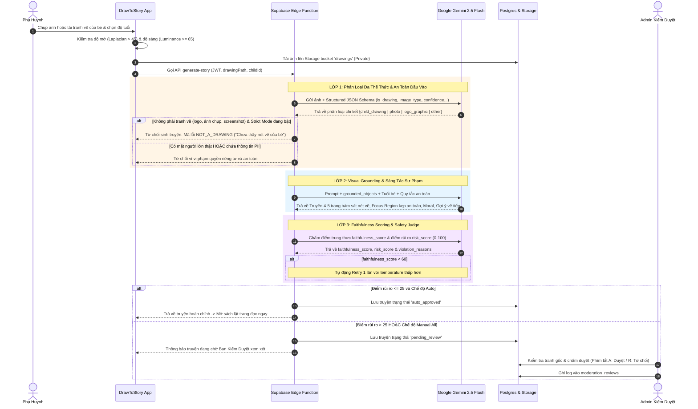

# BÁO CÁO NGHIỆP VỤ & BÀI TOÁN SẢN PHẨM (01-NGHIEP-VU.md)
**Dự án: DrawToStory - Hệ thống Kể Chuyện Thiếu Nhi Thông Minh từ Tranh Bé Vẽ**  
*Môn học: AI Based Programming - Trường Đại học Phú Xuân*  
*Repository:* [https://github.com/nguyendangha10126-svg/Doan-AIBD.git](https://github.com/nguyendangha10126-svg/Doan-AIBD.git)

---

## 1. BÀI TOÁN & BỐI CẢNH THỰC TẾ
Trẻ em trong độ tuổi từ 2 đến 12 tuổi có trí tưởng tượng phong phú và thường thể hiện thế giới nội tâm qua các bức tranh vẽ nguệch ngoạc. Tuy nhiên:
- Phụ huynh hiện đại thường bận rộn, gặp khó khăn trong việc thấu hiểu trọn vẹn câu chuyện đằng sau nét vẽ của con hoặc thiếu thời gian để sáng tác những câu chuyện cổ tích mang tính giáo dục phù hợp với bức tranh.
- Các ứng dụng AI hiện nay trên thị trường phần lớn là chatbot văn bản thuần túy dành cho người lớn, thiếu giao diện trực quan dành riêng cho trẻ em, và quan trọng nhất là **chưa có cơ chế kiểm soát an toàn nghiêm ngặt đối với nội dung tâm lý trẻ nhỏ**.
- Các mô hình AI thông thường khi nhận ảnh đầu vào thường hay bị "ảo giác" (hallucination): ví dụ nhận ảnh logo hoặc ảnh người thật nhưng vẫn cố sinh ra truyện muông thú, hoặc nhận tranh hoa cỏ nhưng lại sáng tác truyện về "chú voi hồng" không hề có trong tranh.

**DrawToStory** ra đời như một cầu nối kỳ diệu: Phụ huynh chỉ cần chụp ảnh bức tranh của bé; hệ thống AI đa phương thức sẽ "ngắm nhìn" bức tranh, thấu cảm nét vẽ, bảo đảm các tiêu chuẩn Responsible AI và dệt nên một câu chuyện tranh cổ tích 4-5 trang có giọng đọc truyền cảm, lật trang sách chân thực, bám sát từng chi tiết bé vẽ (`grounded_objects`) và gợi ý các nét vẽ tiếp theo.

---

## 2. CHÂN DUNG NGƯỜI DÙNG (USER PERSONAS)
1. **Phụ huynh (Primary Persona)**:
   - Mong muốn khuyến khích con sáng tạo, giảm thời gian xem video thụ động (YouTube/TikTok).
   - Cần một công cụ gắn kết gia đình vào mỗi buổi tối trước giờ đi ngủ (Bedtime Storytelling).
   - Quan tâm sâu sắc đến quyền riêng tư, an toàn hình ảnh của con và kiểm soát bằng mã PIN phụ huynh băm SHA-256 an toàn.
2. **Trẻ em 2 - 12 tuổi (End Beneficiary)**:
   - Thích thú khi thấy bức tranh mình tự vẽ được "hóa phép" thành một cuốn sách thật có tên mình.
   - Thưởng thức giọng đọc ấm áp, nhìn tranh phóng to di chuyển theo từng phân cảnh (Ken Burns effect kẹp an toàn không bị crop).
   - Trải nghiệm không gian đọc sách riêng biệt (Kid Mode) với nút bấm lớn $\ge 72px$, âm thanh sinh động và khóa bảo vệ ngăn thoát ứng dụng.
3. **Quản trị viên & Kiểm duyệt viên (Admin Persona)**:
   - Có vai trò thực thụ: Giám sát toàn bộ các câu chuyện bị gắn cờ hoặc có điểm rủi ro AI vượt ngưỡng thông qua Hàng chờ kiểm duyệt (Moderation Queue với Split-View và phím tắt `A`/`R`).
   - Quản lý bộ quy tắc an toàn (Safety Rules), tinh chỉnh System Prompt Studio và bật/tắt chế độ kiểm tra tranh vẽ nghiêm ngặt (`strict_drawing_check`).

---

## 3. MA TRẬN PHÂN QUYỀN (ROLE-BASED ACCESS CONTROL - RBAC)

| Chức năng / Dữ liệu | Khách vãng lai (Guest) | Phụ huynh (User) | Quản trị viên (Admin) |
| :--- | :---: | :---: | :---: |
| Xem trang giới thiệu & An toàn AI (`/trust`) | ✅ | ✅ | ✅ |
| Xem thư viện tokens & components (`/dev/styleguide`) | ✅ | ✅ | ✅ |
| Đọc truyện được chia sẻ công khai (`/shared/:token`) | ✅ | ✅ | ✅ |
| Đăng ký, đăng nhập tài khoản | ✅ | ✅ | ✅ |
| Tạo và quản lý hồ sơ bé (Nickname, Tuổi) | ❌ | ✅ (Chỉ bé của mình) | ✅ (Xem thống kê) |
| Cài đặt & Đổi mã PIN phụ huynh (băm SHA-256) | ❌ | ✅ | ✅ |
| Tải ảnh tranh vẽ & Tạo truyện thần kỳ | ❌ | ✅ (Theo quota ngày) | ✅ (Không giới hạn) |
| Đọc truyện, nghe TTS Karaoke, Chế độ Ru ngủ | ❌ | ✅ (Truyện của bé) | ✅ (Toàn bộ thư viện) |
| Sử dụng Chế độ Trẻ Em (Kid Mode cô lập) | ❌ | ✅ (Cổng khóa 3 nấc) | ✅ |
| Chia sẻ truyện, Xuất PDF / In ấn sách thật | ❌ | ✅ (Truyện đã duyệt) | ✅ |
| Báo cáo truyện vi phạm | ❌ | ✅ | ✅ |
| Xuất toàn bộ dữ liệu cá nhân (GDPR JSON) | ❌ | ✅ (Chỉ dữ liệu mình) | ❌ |
| Hàng chờ kiểm duyệt (Split View, phím tắt A/R) | ❌ | ❌ | ✅ |
| Bật/tắt công tắc Kiểm tra tranh vẽ nghiêm ngặt | ❌ | ❌ | ✅ |
| Quản lý Bộ quy tắc an toàn (CRUD Safety Rules) | ❌ | ❌ | ✅ |
| Chỉnh sửa và thử nghiệm System Prompt Studio | ❌ | ❌ | ✅ |
| Giám sát chi phí AI & Quản lý Hạn mức người dùng | ❌ | ❌ | ✅ |
| Khóa / Mở khóa tài khoản phụ huynh | ❌ | ❌ | ✅ |
| Xem Nhật ký kiểm toán (Audit Logs) | ❌ | ❌ | ✅ |

---

## 4. LUỒNG NGHIỆP VỤ TẠO TRUYỆN TOÀN TRÌNH (END-TO-END WORKFLOW)

---

## 5. BỘ QUY TẮC AN TOÀN TRẺ EM (SAFETY RULES SPECIFICATION)
Hệ thống thiết lập 10 quy tắc phòng hộ thực tế được quản trị trực tiếp trên Database:
1. **Bạo lực & Vũ khí (Mức 5 - Block)**: Tuyệt đối không cho phép vũ khí sát thương, hành vi bạo lực đẫm máu.
2. **Nội dung người lớn (Mức 5 - Block)**: Chặn mọi yếu tố lệch chuẩn với tâm lý trẻ thơ.
3. **Khuôn mặt người thật (Mức 5 - Block)**: Bảo vệ quyền riêng tư trẻ em, ngăn chặn chụp ảnh chân dung trẻ đưa lên mạng.
4. **Thông tin cá nhân PII (Mức 5 - Block)**: Quét và chặn số điện thoại, địa chỉ nhà, tên trường học trên giấy.
5. **Quái vật rùng rợn (Mức 4 - Flag)**: Gắn cờ đưa vào hàng chờ kiểm duyệt để đảm bảo cốt truyện biến bóng ma thành chi tiết tích cực, không gây ám ảnh tâm lý.
6. **Ngôn từ tiêu cực (Mức 4 - Rewrite)**: Yêu cầu AI chuyển hóa thành ngôn ngữ trong sáng, hòa đồng.
7. **Hành vi nguy hiểm bắt chước được (Mức 5 - Block)**: Cấm các hành vi nghịch lửa, leo trèo ban công, sờ ổ điện.
8. **Phân biệt đối xử (Mức 3 - Rewrite)**: Loại bỏ các định kiến ngoại hình, màu da, giới tính.
9. **Bi kịch bế tắc (Mức 4 - Rewrite)**: Đảm bảo câu chuyện luôn có lối thoát tươi sáng và hy vọng.
10. **Xung đột gia đình gay gắt (Mức 4 - Flag)**: Đưa vào hàng chờ để kiểm duyệt viên kiểm tra yếu tố tình cảm gia đình ấm áp.
