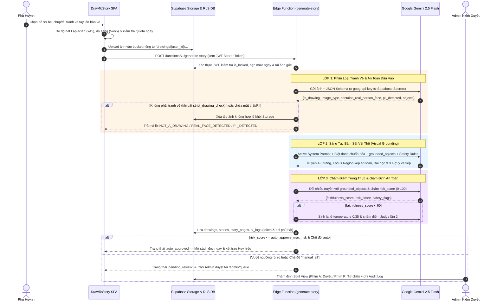

# BÁO CÁO NGHIỆP VỤ & BÀI TOÁN SẢN PHẨM (01-NGHIEP-VU.md)
**Dự án: DrawToStory - Hệ thống Kể Chuyện Thiếu Nhi Thông Minh từ Tranh Bé Vẽ**  
*Môn học: AI Based Programming - Trường Đại học Phú Xuân*  
*Repository:* [https://github.com/nguyendangha10126-svg/Doan-AIBD.git](https://github.com/nguyendangha10126-svg/Doan-AIBD.git)

---

## 1. BÀI TOÁN & BỐI CẢNH THỰC TẾ
Trẻ em trong độ tuổi từ 2 đến 12 tuổi có trí tưởng tượng phong phú và thường thể hiện thế giới nội tâm qua các bức tranh vẽ tay trên giấy. Tuy nhiên:
- Phụ huynh hiện đại thường bận rộn, gặp khó khăn trong việc kết nối câu chuyện đằng sau nét vẽ của con hoặc thiếu thời gian sáng tác những câu chuyện cổ tích mang tính giáo dục phù hợp lứa tuổi.
- Các công cụ AI phổ thông phần lớn thiết kế cho người lớn, thiếu không gian đọc sách an toàn cho trẻ nhỏ và dễ mắc hiện tượng "ảo giác" (*hallucination*): nhận ảnh chụp đời thường hoặc logo nhưng vẫn bịa ra câu chuyện không liên quan tới nét vẽ của trẻ.

**DrawToStory** giải quyết trọn vẹn bài toán trên: Phụ huynh chụp ảnh bức tranh vẽ tay của con; hệ thống **Pipeline AI 3 Lớp Google Gemini 2.5 Flash** chạy bảo mật trên Supabase Edge Functions sẽ phân loại nét vẽ, kiểm định an toàn thiếu nhi và dệt nên cuốn sách cổ tích 4–5 trang bám sát vật thể bé vẽ (`grounded_objects`), tích hợp giọng đọc tiếng Việt truyền cảm, nhạc hộp ru ngủ và gợi ý vẽ tiếp sáng tạo.

---

## 2. CHÂN DUNG NGƯỜI DÙNG (USER PERSONAS)
1. **Phụ huynh (Primary Persona)**:
   - Mong muốn khuyến khích con vẽ tranh trên giấy thật và đọc sách cùng con trước giờ đi ngủ (Bedtime Storytelling).
   - Đòi hỏi sự minh bạch dữ liệu, cô lập tuyệt đối hồ sơ giữa các gia đình và từng bé, bảo vệ bằng mã PIN 4 số riêng băm có Salt và quyền xóa vĩnh viễn tài khoản theo chuẩn GDPR.
   - Được hỗ trợ ngay từ lần đăng nhập đầu tiên bởi **Bảng Hướng dẫn Sử dụng tương tác vuốt ngang (`UserGuideModal`)**.
2. **Trẻ em 2 – 12 tuổi (End Beneficiary)**:
   - Hào hứng khi thấy bức tranh của mình biến thành cuốn sách cổ tích có tên mình (được chuẩn hóa tự nhiên qua `formatChildName`, không bao giờ lặp `"Bé Bé ..."`).
   - Đọc và nghe kể chuyện trong không gian **Chế độ Trẻ Em cô lập (`/kid` & `?mode=kid`)** với nút chạm lớn, toàn màn hình và cổng khóa phụ huynh an toàn.
3. **Quản trị viên & Kiểm duyệt viên (Admin Persona)**:
   - Thẩm định các câu chuyện chờ duyệt hoặc bị báo cáo qua Hàng chờ kiểm duyệt Split View (`/admin/queue`, phím tắt `A`/`R`).
   - Điều chỉnh quy tắc an toàn (`/admin/rules`), phiên bản System Prompt & chạy thử nghiệm AI thật trên máy chủ (`/admin/prompts`), giám sát chi phí USD & biểu đồ đồng bộ thời gian thực (`/admin`, `/admin/costs`) và quản lý hạn mức người dùng (`/admin/users`).

---

## 3. MA TRẬN PHÂN QUYỀN (ROLE-BASED ACCESS CONTROL - RBAC)

| Chức năng / Đường dẫn | Khách vãng lai (Guest) | Phụ huynh (User đang hoạt động) | Quản trị viên (Admin) |
| :--- | :---: | :---: | :---: |
| Đăng nhập, Đăng ký, Quên mật khẩu (`/login`, `/register`, `/forgot-password`) | ✅ | Tự chuyển về `/` | Tự chuyển về `/admin` |
| Đọc truyện chia sẻ công khai hợp lệ (`/shared/:token`) | ✅ | ✅ | ✅ |
| Xem hướng dẫn sử dụng vuốt ngang khi đăng nhập & từ menu tài khoản | ❌ | ✅ (4 bước Phụ huynh) | ✅ (4 bước Quản trị & Phụ huynh) |
| Xem trang cam kết Responsible AI & Số liệu thực (`/trust`) | ❌ | ✅ | ✅ |
| Quản lý hồ sơ cá nhân, Đổi mật khẩu & Mã PIN riêng (`/settings`) | ❌ | ✅ | ✅ |
| Tạo, sửa, xóa hồ sơ bé (cô lập từng gia đình) | ❌ | ✅ (Chỉ gia đình mình) | ✅ (Gia đình mình) |
| Chụp/Tải tranh vẽ & Tạo truyện qua Edge Function (`/create`) | ❌ | ✅ (`min(daily_quota, daily_story_limit)`) | ✅ |
| Đọc truyện lật trang, TTS Karaoke, Nhạc Ru ngủ (`/story/:id`) | ❌ | ✅ (Truyện gia đình mình) | ✅ (Toàn bộ thư viện để kiểm duyệt) |
| Chế độ Trẻ Em cô lập (`/kid`, `/kid-mode` → `/kid`, `?mode=kid`) | ❌ | ✅ (Mở khóa bằng PIN riêng / Toán người lớn) | ✅ |
| Chia sẻ công khai, Xuất PDF / In sách, Báo cáo nội dung | ❌ | ✅ (Truyện gia đình mình) | ✅ |
| Xuất JSON & Xóa vĩnh viễn tài khoản GDPR (`delete-account`) | ❌ | ✅ (Xác thực lại mật khẩu + gõ `XOA`) | ✅ |
| Tổng quan KPI & Biểu đồ Recharts 3 (`/admin`, `/admin/overview` → `/admin`) | ❌ | ❌ | ✅ |
| Hàng chờ kiểm duyệt Split View (`/admin/queue`, `/admin/moderation` → `/admin/queue`) | ❌ | ❌ | ✅ |
| Quản lý Bộ quy tắc an toàn CRUD (`/admin/rules`) | ❌ | ❌ | ✅ |
| System Prompt Studio & AI Playground Server-Side (`/admin/prompts`) | ❌ | ❌ | ✅ |
| Giám sát chi phí AI, Ngân sách tháng & Xuất CSV (`/admin/costs`) | ❌ | ❌ | ✅ |
| Quản lý Hạn mức & Khóa/Mở khóa tài khoản (`/admin/users`) | ❌ | ❌ | ✅ |
| Cấu hình Kiểm duyệt & Hướng dẫn Supabase Secrets (`/admin/settings`) | ❌ | ❌ | ✅ |
| Nhật ký kiểm toán hệ thống (`/admin/audit`) | ❌ | ❌ | ✅ |
| Thư viện Design Tokens (`/dev/styleguide`) | Chỉ mở trên môi trường `DEV` cục bộ (Tự động gỡ khỏi bản Production) | | |

---

## 4. LUỒNG NGHIỆP VỤ HƯỚNG DẪN SỬ DỤNG & TẠO TRUYỆN TOÀN TRÌNH

### 4.1. Luồng Hướng dẫn Sử dụng Thông minh (`UserGuideModal`)
1. **Tự động mở khi vừa đăng nhập**: Ngay khi Phụ huynh hoặc Admin đăng nhập thành công, hộp thoại hướng dẫn 4 bước mở ra tương ứng với vai trò tài khoản.
2. **Tương tác linh hoạt**: Người dùng có thể vuốt ngang trên màn hình cảm ứng, bấm nút Trước/Tiếp, bấm chấm chuyển slide, nhấn **"Đóng"** (ẩn trong phiên đăng nhập hiện tại) hoặc nhấn **"Tắt & Không hiện lại"** (lưu trạng thái theo `userId` để các lần đăng nhập sau không tự bật nữa).
3. **Mở lại mọi lúc**: Trong menu thả xuống của tài khoản (cả giao diện Phụ huynh `UserLayout` và Quản trị `AdminLayout`), nút **"Hướng dẫn sử dụng"** được đặt cố định ngay phía trên nút **"Đăng xuất"**, cho phép xem lại hướng dẫn và bật lại chế độ tự hiện khi cần.

### 4.2. Sơ đồ Tuần tự Tạo Truyện Bảo mật qua Edge Function

---

## 5. BỘ 10 QUY TẮC AN TOÀN TRẺ EM & 5 HUY HIỆU GAMIFICATION

### 5.1. 10 Quy tắc Phòng hộ Tâm lý Thiếu nhi (`public.safety_rules`)
1. **Bạo lực & Vũ khí (Mức 5 – Block)**: Chặn tuyệt đối vũ khí sát thương và hành vi bạo lực.
2. **Nội dung người lớn (Mức 5 – Block)**: Chặn mọi yếu tố nhạy cảm không phù hợp trẻ nhỏ.
3. **Khuôn mặt người thật (Mức 5 – Block)**: Chặn ảnh chụp chân dung người thật để bảo vệ quyền riêng tư.
4. **Thông tin cá nhân PII (Mức 5 – Block)**: Chặn ảnh chứa số điện thoại, địa chỉ nhà, tên trường lớp.
5. **Quái vật rùng rợn (Mức 4 – Flag)**: Đưa vào hàng chờ kiểm duyệt để đảm bảo không gây sợ hãi.
6. **Ngôn từ tiêu cực (Mức 4 – Rewrite)**: Chuyển hóa thành ngôn từ khích lệ, ấm áp.
7. **Hành vi nguy hiểm bắt chước được (Mức 5 – Block)**: Cấm hành vi nghịch lửa, điện, leo trèo nguy hiểm.
8. **Phân biệt đối xử (Mức 3 – Rewrite)**: Loại bỏ định kiến ngoại hình, giới tính, vùng miền.
9. **Bi kịch bế tắc (Mức 4 – Rewrite)**: Đảm bảo kết truyện luôn tươi sáng và giàu hy vọng.
10. **Xung đột gia đình gay gắt (Mức 4 – Flag)**: Chuyển kiểm duyệt viên rà soát yếu tố gắn kết gia đình.

### 5.2. 5 Huy hiệu Sáng tạo Tự động theo Từng Bé (`public.badges` & `public.user_badges`)
1. **Tác Giả Nhí Đầu Tiên (`first_story`)**: Hoàn thành cuốn sách cổ tích đầu tiên được duyệt.
2. **Nhà Thám Hiểm Sắc Màu (`art_explorer`)**: Bức tranh sử dụng từ 5 gam màu phong phú trở lên.
3. **Bạn Nhỏ Giờ Đi Ngủ (`bedtime_reader`)**: Đọc hoặc nghe kể chuyện trong Chế độ Ru ngủ.
4. **Chuỗi 3 Ngày Sáng Tạo (`streak_3`)**: Duy trì hoạt động sáng tác/đọc sách 3 ngày liên tiếp.
5. **Bậc Thầy Kể Chuyện (`master_storyteller`)**: Tủ sách của bé cán mốc 10 cuốn truyện đã duyệt.
