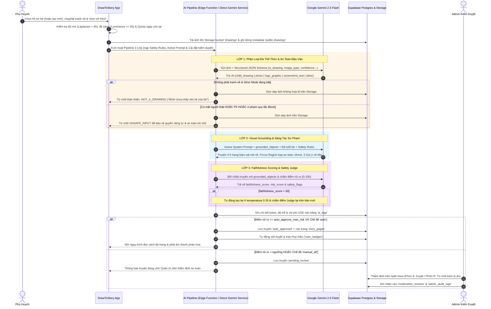

# BÁO CÁO NGHIỆP VỤ & BÀI TOÁN SẢN PHẨM (01-NGHIEP-VU.md)
**Dự án: DrawToStory - Hệ thống Kể Chuyện Thiếu Nhi Thông Minh từ Tranh Bé Vẽ**  
*Môn học: AI Based Programming - Trường Đại học Phú Xuân*  
*Repository:* [https://github.com/nguyendangha10126-svg/Doan-AIBD.git](https://github.com/nguyendangha10126-svg/Doan-AIBD.git)

---

## 1. BÀI TOÁN & BỐI CẢNH THỰC TẾ
Trẻ em trong độ tuổi từ 2 đến 12 tuổi có trí tưởng tượng phong phú và thường thể hiện thế giới nội tâm qua các bức tranh vẽ nguệch ngoạc. Tuy nhiên:
- Phụ huynh hiện đại thường bận rộn, gặp khó khăn trong việc thấu hiểu trọn vẹn câu chuyện đằng sau nét vẽ của con hoặc thiếu thời gian để sáng tác những câu chuyện cổ tích mang tính giáo dục phù hợp với bức tranh.
- Các ứng dụng AI hiện nay trên thị trường phần lớn là chatbot văn bản thuần túy dành cho người lớn, thiếu giao diện trực quan dành riêng cho trẻ em, và quan trọng nhất là **chưa có cơ chế kiểm soát an toàn nghiêm ngặt đối với nội dung tâm lý trẻ nhỏ**.
- Các mô hình AI thông thường khi nhận ảnh đầu vào thường hay bị "ảo giác" (hallucination): ví dụ nhận ảnh logo hoặc ảnh chụp người thật nhưng vẫn cố sinh ra truyện muông thú, hoặc nhận tranh hoa cỏ nhưng lại sáng tác truyện về "chú voi hồng" không hề có trong tranh.

**DrawToStory** ra đời như một cầu nối kỳ diệu: Phụ huynh chỉ cần chụp ảnh bức tranh của bé; hệ thống AI đa phương thức **Gemini 2.5 Flash** sẽ "ngắm nhìn" bức tranh, thấu cảm nét vẽ, bảo đảm các tiêu chuẩn Responsible AI và dệt nên một câu chuyện tranh cổ tích 4–5 trang có giọng đọc tiếng Việt truyền cảm, nhạc hộp ru ngủ êm dịu, lật trang sách chân thực, bám sát từng chi tiết bé vẽ (`grounded_objects`) và gợi ý các nét vẽ tiếp theo.

---

## 2. CHÂN DUNG NGƯỜI DÙNG (USER PERSONAS)
1. **Phụ huynh (Primary Persona)**:
   - Mong muốn khuyến khích con sáng tạo, giảm thời gian xem video thụ động (YouTube/TikTok).
   - Cần một công cụ gắn kết gia đình vào mỗi buổi tối trước giờ đi ngủ (Bedtime Storytelling).
   - Quan tâm sâu sắc đến quyền riêng tư, cô lập dữ liệu từng gia đình/từng bé, quản lý tài khoản cá nhân và kiểm soát bằng mã PIN phụ huynh băm SHA-256 an toàn.
2. **Trẻ em 2 – 12 tuổi (End Beneficiary)**:
   - Thích thú khi thấy bức tranh mình tự vẽ được "hóa phép" thành một cuốn sách thật có tên mình và nhận các huy hiệu khen thưởng lấp lánh.
   - Thưởng thức giọng đọc ấm áp cùng nhạc hộp ru ngủ, nhìn tranh phóng to di chuyển theo từng phân cảnh (Ken Burns effect kẹp an toàn không bị crop).
   - Trải nghiệm không gian đọc sách riêng biệt (Kid Mode `?mode=kid`) với nút bấm lớn $\ge 72\text{px}$, âm thanh sinh động và cổng bảo vệ ngăn thoát sang giao diện người lớn.
3. **Quản trị viên & Kiểm duyệt viên (Admin Persona)**:
   - Giám sát toàn bộ các câu chuyện bị gắn cờ hoặc có điểm rủi ro AI vượt ngưỡng thông qua Hàng chờ kiểm duyệt (Moderation Queue với Split-View và phím tắt `A`/`R`).
   - Cấu hình khóa Gemini API Key trực tiếp trên giao diện, quản lý bộ quy tắc an toàn (Safety Rules), thử nghiệm System Prompt Studio thời gian thực, điều tiết ngân sách tháng và quản lý hạn mức / khóa tài khoản vi phạm.

---

## 3. MA TRẬN PHÂN QUYỀN (ROLE-BASED ACCESS CONTROL - RBAC)

| Chức năng / Dữ liệu | Khách vãng lai (Guest) | Phụ huynh (User đang hoạt động) | Quản trị viên (Admin) |
| :--- | :---: | :---: | :---: |
| Đăng nhập, Đăng ký, Quên mật khẩu (`/login`, `/register`, `/forgot-password`) | ✅ | ✅ (Tự chuyển về `/`) | ✅ (Tự chuyển về `/admin`) |
| Đọc truyện được chia sẻ công khai hợp lệ (`/shared/:token`) | ✅ | ✅ | ✅ |
| Xem thư viện tokens & components (`/dev/styleguide`) | ✅ | ✅ | ✅ |
| Xem trang cam kết An toàn AI (`/trust`) | ❌ | ✅ | ✅ |
| Quản lý hồ sơ cá nhân & Đổi mật khẩu (`/settings`) | ❌ | ✅ | ✅ |
| Tạo, sửa, xóa hồ sơ bé (cho phép xóa về 0 bé) | ❌ | ✅ (Chỉ gia đình mình) | ✅ (Gia đình mình & xem thống kê) |
| Cài đặt & Đổi mã PIN phụ huynh (băm SHA-256) | ❌ | ✅ | ✅ |
| Tải ảnh tranh vẽ & Tạo truyện thần kỳ (`/create`) | ❌ | ✅ (Theo `min(daily_quota, daily_story_limit)`, mặc định 5/ngày) | ✅ (Mặc định 100/ngày, tùy chỉnh) |
| Đọc truyện, nghe TTS Karaoke, Nhạc Ru ngủ (`/story/:id`) | ❌ | ✅ (Truyện gia đình mình) | ✅ (Toàn bộ thư viện để kiểm duyệt) |
| Mở khóa 5 Huy hiệu Gamification & Chuỗi ngày đọc | ❌ | ✅ (Tự động theo bé/gia đình) | ✅ |
| Sử dụng Chế độ Trẻ Em cô lập (`/kid` & `?mode=kid`) | ❌ | ✅ (Cổng khóa 3 cơ chế) | ✅ |
| Chia sẻ công khai (tự bật `is_shared`), Xuất PDF / In sách | ❌ | ✅ (Truyện đã duyệt của mình) | ✅ |
| Báo cáo truyện vi phạm (`pending_review`) | ❌ | ✅ | ✅ |
| Xuất dữ liệu cá nhân (GDPR JSON) & Xóa sạch dữ liệu gia đình | ❌ | ✅ (Chỉ dữ liệu gia đình mình) | ✅ (Dữ liệu cá nhân mình) |
| Tổng quan hệ thống 7 ngày / 30 ngày (`/admin`) | ❌ | ❌ | ✅ |
| Hàng chờ kiểm duyệt Split View, phím tắt `A`/`R` (`/admin/moderation`) | ❌ | ❌ | ✅ |
| Cấu hình Gemini API Key, Strict Drawing Check & Ngưỡng rủi ro (`/admin/settings`) | ❌ | ❌ | ✅ |
| Quản lý Bộ quy tắc an toàn CRUD (`/admin/safety-rules`) | ❌ | ❌ | ✅ |
| Chỉnh sửa & Chạy thử Gemini thật tại Prompt Studio (`/admin/prompts`) | ❌ | ❌ | ✅ |
| Giám sát chi phí AI, Ngân sách tháng & Xuất CSV (`/admin/costs`) | ❌ | ❌ | ✅ |
| Quản lý Hạn mức & Khóa/Mở khóa tài khoản (chống tự khóa mình) (`/admin/users`) | ❌ | ❌ | ✅ |
| Xem & Tra cứu Nhật ký kiểm toán (`/admin/audit`) | ❌ | ❌ | ✅ |

> **Cơ chế cưỡng chế tài khoản bị khóa (`is_locked = true`)**: Ngay khi Admin khóa một tài khoản, cả tầng RLS PostgreSQL (`is_active_user()`) lẫn tầng Frontend Guard tự động thu hồi phiên làm việc và chặn đăng nhập với thông báo rõ ràng.

---

## 4. LUỒNG NGHIỆP VỤ TẠO TRUYỆN TOÀN TRÌNH (END-TO-END WORKFLOW)

---

## 5. BỘ QUY TẮC AN TOÀN TRẺ EM (SAFETY RULES SPECIFICATION)
Hệ thống thiết lập 10 quy tắc phòng hộ thực tế được quản trị trực tiếp trên Database (`public.safety_rules`):
1. **Bạo lực & Vũ khí (Mức 5 - Block)**: Tuyệt đối không cho phép vũ khí sát thương, hành vi bạo lực đẫm máu.
2. **Nội dung người lớn (Mức 5 - Block)**: Chặn mọi yếu tố lệch chuẩn với tâm lý trẻ thơ.
3. **Khuôn mặt người thật (Mức 5 - Block)**: Bảo vệ quyền riêng tư trẻ em, ngăn chặn chụp ảnh chân dung thật đưa lên mạng.
4. **Thông tin cá nhân PII (Mức 5 - Block)**: Quét và chặn số điện thoại, địa chỉ nhà, tên trường học trên giấy.
5. **Quái vật rùng rợn (Mức 4 - Flag)**: Gắn cờ đưa vào hàng chờ kiểm duyệt để đảm bảo cốt truyện biến bóng tối thành chi tiết tích cực, không gây ám ảnh tâm lý.
6. **Ngôn từ tiêu cực (Mức 4 - Rewrite)**: Yêu cầu AI chuyển hóa thành ngôn ngữ trong sáng, khích lệ và hòa đồng.
7. **Hành vi nguy hiểm bắt chước được (Mức 5 - Block)**: Cấm các hành vi nghịch lửa, leo trèo ban công, sờ ổ điện.
8. **Phân biệt đối xử (Mức 3 - Rewrite)**: Loại bỏ các định kiến ngoại hình, màu da, giới tính.
9. **Bi kịch bế tắc (Mức 4 - Rewrite)**: Đảm bảo câu chuyện luôn có lối thoát tươi sáng và hy vọng.
10. **Xung đột gia đình gay gắt (Mức 4 - Flag)**: Đưa vào hàng chờ để kiểm duyệt viên kiểm tra yếu tố tình cảm gia đình ấm áp.

---

## 6. HỆ THỐNG GAMIFICATION & GẮN KẾT GIA ĐÌNH (5 HUY HIỆU TỰ ĐỘNG)
Mỗi hành trình sáng tạo và đọc sách của bé đều được ghi nhận thực tế trong `reading_events` và `user_badges` kèm thanh tiến độ trực quan trên Bảng điều khiển:
1. **Tác Giả Nhí Đầu Tiên (`first_story`)**: Mở khóa ngay khi gia đình hoàn thành cuốn truyện cổ tích đầu tiên từ tranh vẽ.
2. **Nhà Thám Hiểm Sắc Màu (`art_explorer`)**: Trao tặng khi bé sáng tạo đạt mốc **5 cuốn truyện** từ các bức vẽ khác nhau.
3. **Bạn Nhỏ Giờ Đi Ngủ (`bedtime_reader`)**: Tự động mở khóa khi bé hoàn thành đọc hết một cuốn truyện trong **Chế độ Ru ngủ (Bedtime Mode)**.
4. **Chuỗi 3 Ngày Đọc Sách (`streak_3`)**: Ghi nhận thói quen đọc sách liên tục trong **3 ngày liên tiếp** dựa trên lịch sử `reading_events`.
5. **Bậc Thầy Kể Chuyện (`master_storyteller`)**: Danh hiệu cao quý khi tủ sách của gia đình cán mốc **10 cuốn truyện đã duyệt** và tích lũy tối thiểu **30 phút nghe đọc**.

---

## 7. KIẾN TRÚC DỮ LIỆU SẠCH & ĐỒNG BỘ THỜI GIAN THỰC (CLEAN DATA ARCHITECTURE)
Hệ thống vận hành trên kiến trúc **Clean Database-First** hoàn chỉnh:
1. **Khởi đầu sạch 100%**: Chạy `supabase/full_setup.sql` tạo đúng 2 tài khoản GoTrue thật (`admin@drawtostory.vn` và `me@phuhuynh.vn`), 0 hồ sơ bé, 0 bức tranh và 0 cuốn truyện mẫu. Phụ huynh tự tay thêm bé và sáng tạo trên dữ liệu thực.
2. **Cô lập theo bé đang chọn (Active Child Scoping)**: Khi phụ huynh chuyển đổi giữa các bé trên thanh điều hướng, Bảng điều khiển, Tủ sách và Chế độ bé tự động lọc đúng sách, số phút đọc và chuỗi ngày đọc của bé đó.
3. **Dọn dẹp dữ liệu trọn vẹn (Zero Orphaned Files)**: Khi phụ huynh xóa một cuốn truyện, xóa hồ sơ bé hoặc chọn xóa toàn bộ dữ liệu gia đình trong Cài đặt, hệ thống tự động xóa cả bản ghi cơ sở dữ liệu lẫn tệp ảnh gốc trong Supabase Storage bucket `drawings`.
