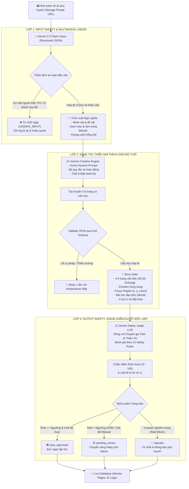

# KIẾN TRÚC PIPELINE AI & TIÊU CHUẨN RESPONSIBLE AI (02-GIAO-DIEN-AI.md)
**Dự án: DrawToStory - Hệ thống Kể Chuyện Thiếu Nhi Thông Minh từ Tranh Bé Vẽ**  
*Môn học: AI Based Programming - Trường Đại học Phú Xuân*

---

## 1. TỔNG QUAN KIẾN TRÚC PIPELINE AI 3 LỚP

Hệ thống AI của **DrawToStory** không phải là một chatbot giao tiếp thông thường mà là một **pipeline xử lý đa tầng (3-Layer Multi-Stage AI Pipeline)** chạy độc lập trong môi trường bảo mật của Supabase Edge Functions (Deno Runtime). 

Mô hình AI đóng vai trò **trung tâm cốt lõi (Core Engine)**, quyết định toàn bộ giá trị trải nghiệm sản phẩm:
- Chuyển đổi các nét vẽ nguệch ngoạc đa phương thức thành dữ liệu ngữ nghĩa.
- Tạo cốt truyện song hành cùng cảm xúc nhân vật và tọa độ thị giác (Ken Burns effect).
- Thẩm định an toàn tâm lý thiếu nhi đa tầng trước khi hiển thị cho trẻ.



---

## 2. CHI TIẾT CÁC LỚP TRONG PIPELINE

### 2.1. LỚP 1: INPUT SAFETY & THẤU CẢM TRANH VẼ (MULTIMODAL VISION)
- **Mục tiêu**: Đảm bảo ảnh gửi lên thực sự là tranh vẽ của trẻ em, không chứa ảnh chụp người thật, không làm rò rỉ thông tin cá nhân (PII), và trích xuất đặc trưng thị giác để làm chất liệu sáng tác.
- **Input**: Signed URL của ảnh trong Supabase Storage bucket `drawings` (chỉ cấp quyền đọc tạm thời trong 60 giây).
- **Gemini Model**: Đọc từ biến môi trường `GEMINI_MODEL` (mặc định `gemini-2.5-flash`), gọi qua Google AI REST API với `responseMimeType: "application/json"`.
- **JSON Schema Đầu ra của Lớp 1**:
```json
{
  "is_drawing": true,
  "contains_real_person_face": false,
  "pii_detected": false,
  "confidence": 0.95,
  "risk_categories": [],
  "rejection_reason": null,
  "objects": ["chú mèo", "ngôi nhà mái ngói", "ông mặt trời mỉm cười", "cây táo"],
  "colors": ["hồng pastel", "xanh lá", "vàng tươi"],
  "mood": "vui tươi, ấm áp, hồn nhiên",
  "characters": ["chú mèo lông cam biết cười", "mặt trời thân thiện"]
}
```
- **Xử lý vi phạm**: Nếu `is_drawing === false` hoặc `contains_real_person_face === true` hoặc `pii_detected === true`, Edge Function lập tức ngắt pipeline, ghi nhật ký `ai_logs` với mã lỗi `UNSAFE_INPUT`, và trả về phản hồi giải thích thân thiện cho phụ huynh.

---

### 2.2. LỚP 2: SÁNG TÁC NỘI DUNG THÍCH ỨNG ĐỘ TUỔI (CREATIVE GENERATION)
- **Mục tiêu**: Dựa trên các đặc trưng thị giác từ Lớp 1, biến các nhân vật và màu sắc của bé thành một câu chuyện cổ tích 4-5 trang.
- **Cơ chế Prompt Ghép Động (Dynamic Prompt Assembly)**:
  Prompt truyền vào Gemini được hợp nhất từ 3 nguồn:
  1. **Active System Prompt**: Được lấy trực tiếp từ bảng `system_prompts` trong Database (có thể tinh chỉnh qua Admin Studio mà không cần deploy lại code).
  2. **Bộ quy tắc an toàn động**: Lấy từ bảng `safety_rules` với điều kiện `is_active = true`, ép mô hình không được tạo ra từ ngữ đe dọa, ám ảnh hoặc bạo lực.
  3. **Hồ sơ bé**: Biệt danh và tuổi của bé (từ bảng `children`).
- **Thích ứng Ngôn ngữ theo Độ Tuổi (Age Adaptation)**:
  - **Nhóm 2 - 4 tuổi (Mầm non)**: Từ vựng đơn giản, từ tượng thanh (`meo meo`, `lấp lánh`, `vù vù`), câu ngắn gọn (5-7 từ), lặp lại nhịp điệu, tập trung vào màu sắc và tình bạn.
  - **Nhóm 5 - 7 tuổi (Tiểu học cơ sở)**: Cốt truyện có mở đầu - diễn biến - kết thúc rõ ràng, phát triển lòng tốt, sự dũng cảm, biết chia sẻ và bảo vệ môi trường.
  - **Nhóm 8 - 12 tuổi (Tiểu học lớn)**: Cốt truyện phiêu lưu, suy nghĩ nội tâm, giải quyết vấn đề sáng tạo, từ vựng phong phú, liên tưởng khoa học viễn tưởng hoặc thế giới kỳ diệu.
- **Ràng buộc Định dạng Trang (Story Page Constraints)**:
  - Độ dài mỗi trang: 30 - 50 từ tiếng Việt.
  - Cảm xúc (`emotion`): `joyful`, `curious`, `excited`, `peaceful`, `sleepy`.
  - Tọa độ phóng to bức tranh (`focus_region`): `{ "x": number, "y": number, "zoom": number }`. Tọa độ này được client sử dụng cho hiệu ứng thị giác Ken Burns: camera từ từ lướt và zoom vào đúng nhân vật mà trang đó đang kể.
  - `moral`: Bài học nhân văn cô đọng (1-2 câu).
  - `next_drawing_ideas`: 3 gợi ý vẽ tiếp phần sau của câu chuyện để kích thích trí tưởng tượng của bé.
- **Cơ chế Tự Sửa Lỗi (Schema Validation & Retry)**: Dữ liệu trả về được kiểm định bằng Zod Schema (`StoryGenerationOutputSchema`). Nếu cấu trúc JSON bị thiếu trường hoặc sai kiểu, hàm tự động retry 1 lần với temperature thấp hơn (`temperature: 0.3`).

---

### 2.3. LỚP 3: KIỂM DUYỆT ĐỘC LẬP (OUTPUT SAFETY JUDGE)
- **Mục tiêu**: Thực hiện nguyên tắc "Không để AI tự phê duyệt sản phẩm của chính nó mà không qua kiểm tra chéo". Một phiên Gemini độc lập đóng vai trò Chuyên gia Kiểm duyệt Nội dung Thiếu nhi.
- **Đầu vào**: Toàn bộ nội dung truyện vừa tạo ở Lớp 2 + Danh sách `safety_rules` đang kích hoạt.
- **Thang điểm Rủi ro (Risk Score)**:
  - Mô hình chấm điểm từ 0 (Hoàn toàn an toàn) đến 100 (Cực kỳ nguy hại).
  - Trả về danh sách `reasons` giải thích từng tiêu chí: có yếu tố rùng rợn, ác mộng, phân biệt đối xử, xúi giục hành vi nguy hiểm không.
- **Thuật toán Định tuyến**:
  ```typescript
  if (hasBlockingViolation) {
    status = 'rejected';
  } else if (appSettings.moderation_mode === 'manual_all' || risk_score > appSettings.auto_approve_max_risk) {
    status = 'pending_review'; // Đưa vào hàng chờ Admin
  } else {
    status = 'auto_approved';  // Phụ huynh và bé có thể đọc ngay
  }
  ```

---

## 3. THÔNG SỐ KỸ THUẬT & KIẾN TRÚC EDGE FUNCTIONS

### 3.1. Danh mục Edge Functions
1. `generate-story`: Tiếp nhận yêu cầu tạo truyện, thực thi trọn vẹn Pipeline 3 Lớp, lưu kết quả vào Supabase Database, trả về kết quả hoặc trạng thái chờ duyệt.
2. `get-shared-story`: Cung cấp API đọc truyện công khai thông qua `share_token` (không cần đăng nhập, bảo vệ quyền riêng tư bằng cách chỉ trả thông tin đã được duyệt).
3. `admin-test-prompt`: API dành riêng cho Admin trong Prompt Studio để thử nghiệm prompt mới với ảnh mẫu và so sánh chất lượng.

### 3.2. Cấu hình & Xử lý Ngoại lệ
- **Timeout**: Mỗi bước gọi Gemini được giới hạn `AbortSignal.timeout(25000)` (25 giây).
- **Cơ chế Retry**: Khi gặp mã lỗi `429 (Rate Limit)` hoặc `503 (Overloaded)`, hệ thống tự động thực hiện Exponential Backoff (chờ $1000 \times 2^n$ ms) tối đa 2 lần.
- **Bảng Mã Lỗi Chuẩn Hóa**:
  - `UNSAFE_INPUT`: Ảnh không phải tranh vẽ, có mặt người thật hoặc PII.
  - `RATE_LIMITED`: Vượt quá hạn mức yêu cầu API của Google Gemini.
  - `TIMEOUT`: Quá thời gian phản hồi 25s từ mô hình AI.
  - `QUOTA_EXCEEDED`: Phụ huynh đã dùng hết số lượt tạo truyện trong ngày.
  - `PARSING_ERROR`: Mô hình trả về định dạng sai lệch không thể phục hồi.
  - `INTERNAL_ERROR`: Lỗi hệ thống nội bộ.

### 3.3. Tính toán Chi phí & Nhật ký AI Logs
Mỗi lời gọi API được ghi nhận vào bảng `ai_logs` với công thức tính chi phí:
$$\text{Cost} = \frac{\text{Input Tokens} \times 0.075}{1\,000\,000} + \frac{\text{Output Tokens} \times 0.30}{1\,000\,000}\quad (\text{USD cho Gemini 2.5 Flash})$$
Hệ thống tuyệt đối **không lưu trữ base64 của ảnh** vào bảng logs để tiết kiệm dung lượng và bảo vệ quyền riêng tư.

---

## 4. KHUNG NGUYÊN TẮC RESPONSIBLE AI (TRÁCH NHIỆM TRÍ TUỆ NHÂN TẠO)

Dự án **DrawToStory** tuân thủ nghiêm ngặt 5 trụ cột của Google Responsible AI:

| Trụ cột | Ứng dụng cụ thể trong DrawToStory |
| :--- | :--- |
| **1. An toàn Trẻ em (Child Safety)** | Kiểm duyệt 2 chiều (ảnh đầu vào + văn bản đầu ra). Chặn triệt để hình ảnh người thật, chống nhận diện khuôn mặt và quét thông tin PII. |
| **2. Minh bạch & Giải trình (Explainability)** | Phụ huynh và Admin luôn biết lý do vì sao một câu chuyện bị từ chối hoặc phải đưa vào hàng chờ kiểm duyệt (Risk Score + Risk Reasons). |
| **3. Con người làm chủ (Human-in-the-loop)** | Quản trị viên có toàn quyền can thiệp, duyệt/từ chối câu chuyện trong Moderation Queue và cập nhật Safety Rules theo thời gian thực. |
| **4. Công bằng & Không định kiến (Fairness)** | Nội dung truyện luôn khuyến khích hòa nhập, không phân biệt giới tính, màu da, vùng miền hay hoàn cảnh gia đình. |
| **5. Quyền riêng tư & Bảo mật (Privacy)** | Toàn bộ ảnh tranh vẽ được lưu trong Storage Private Bucket; chỉ truy cập qua Signed URL tạm thời. Dữ liệu tài khoản chỉ lưu biệt danh bé, không lưu họ tên thật. |

---

## 5. GIỚI HẠN KỸ THUẬT & HƯỚNG PHÁT TRIỂN (LIMITATIONS)
- **Hạn chế hiện tại**: Mô hình Vision có thể bị đánh lừa bởi những bức tranh vẽ kỹ thuật số siêu thực trông giống ảnh chụp thật. Web Speech API phụ thuộc vào giọng đọc cài sẵn của hệ điều hành trên thiết bị người dùng.
- **Hướng phát triển**: Tích hợp mô hình Diffusion cục bộ để tạo thêm tranh minh họa phụ trợ; nâng cấp TTS giọng đọc tiếng Việt bằng AI Voice Cloning gia đình an toàn.

