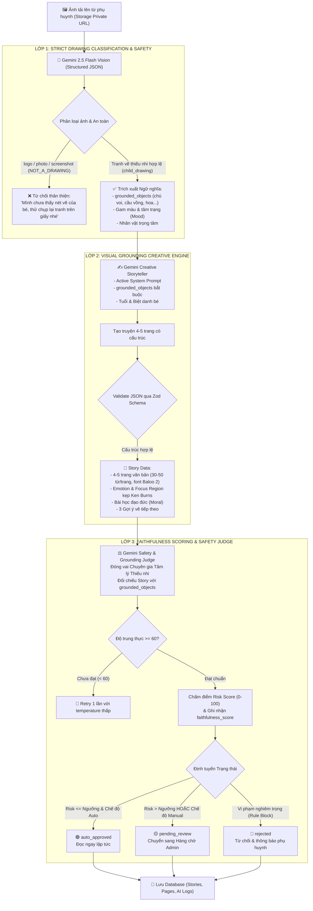

# KIẾN TRÚC PIPELINE AI & TIÊU CHUẨN RESPONSIBLE AI (02-GIAO-DIEN-AI.md)
**Dự án: DrawToStory - Hệ thống Kể Chuyện Thiếu Nhi Thông Minh từ Tranh Bé Vẽ**  
*Môn học: AI Based Programming - Trường Đại học Phú Xuân*  
*Repository:* [https://github.com/nguyendangha10126-svg/Doan-AIBD.git](https://github.com/nguyendangha10126-svg/Doan-AIBD.git)

---

## 1. TỔNG QUAN KIẾN TRÚC PIPELINE AI 3 LỚP (RESPONSIBLE AI PIPELINE)

Hệ thống AI của **DrawToStory** vận hành một **pipeline xử lý đa tầng (3-Layer Multi-Stage AI Pipeline)** chạy độc lập trong môi trường bảo mật của Supabase Edge Functions (Deno Runtime). 

Mô hình AI đóng vai trò **trung tâm cốt lõi (Core Engine)**, loại bỏ triệt để các hạn chế trước đây (ảnh logo/ảnh chụp đời thường bị biến thành truyện thú hoang dại, hoặc AI tưởng tượng ra nhân vật không có trong tranh):
- **Layer 1: Phân loại tranh vẽ đa phương thức & An toàn đầu vào**: Nhận diện chính xác loại ảnh (`child_drawing`, `artwork`, `photo`, `logo_graphic`, `screenshot_text`, `other`), độ tin cậy `confidence`, kiểm tra khuôn mặt người thật và PII. Nếu không phải tranh vẽ trẻ em và chế độ nghiêm ngặt đang bật, trả về mã lỗi thân thiện `NOT_A_DRAWING`.
- **Layer 2: Sáng tác bám sát nét vẽ (Visual Grounding Engine)**: Bắt buộc truyện phải xoay quanh các vật thể thực tế bé đã vẽ (`grounded_objects`), chỉ định cảm xúc và tọa độ camera Ken Burns kẹp an toàn (`focus_region`).
- **Layer 3: Chấm điểm trung thực & Thẩm định an toàn độc lập (Judge & Faithfulness)**: Tính toán `faithfulness_score` (0-100) đối chiếu truyện với nét vẽ, tự động thử lại nếu điểm dưới 60, đồng thời chấm điểm rủi ro `risk_score` theo 10 quy tắc an toàn thiếu nhi.



---

## 2. CHI TIẾT CÁC LỚP TRONG PIPELINE

### 2.1. LỚP 1: PHÂN LOẠI TRANH VẼ ĐA PHƯƠNG THỨC (STRICT DRAWING CLASSIFICATION)
- **Cơ chế**: Prompt của Gemini phân tích hình ảnh và trả về JSON có cấu trúc chứa:
  - `is_drawing`: boolean.
  - `image_type`: enum `child_drawing | artwork | logo_graphic | photo | screenshot_text | other`.
  - `confidence`: số từ 0.0 đến 1.0.
  - `contains_real_person_face`: boolean.
  - `pii_detected`: boolean.
  - `objects`, `colors`, `mood`, `characters`: danh sách chuỗi trích xuất.
- **Quy tắc chặn nghiêm ngặt (Strict Drawing Check)**:
  - Nếu `image_type` thuộc `{ 'logo_graphic', 'photo', 'screenshot_text' }` hoặc `!is_drawing`: hàm trả về lỗi `NOT_A_DRAWING` kèm thông điệp rõ ràng hướng dẫn cha mẹ chụp lại tranh vẽ trên giấy.
  - Có thể chuyển đổi cờ `strict_drawing_check` trong trang Cài đặt kiểm duyệt (`/admin/settings`) để phục vụ kiểm thử demo.

### 2.2. LỚP 2: SÁNG TÁC BÁM SÁT NÉT VẼ (STRICT VISUAL GROUNDING)
- **Cơ chế**: Truyền danh sách `grounded_objects` từ Lớp 1 vào ngữ cảnh tạo truyện.
- **Ràng buộc**:
  - Từng trang truyện bắt buộc phải xuất hiện ít nhất một đồ vật/nhân vật do chính bé vẽ.
  - Không được tự ý đưa vào các sinh vật không hề có trong tranh nếu tranh chỉ vẽ các đối tượng đơn giản (ví dụ tranh chỉ vẽ hoa thì tập trung vào bạn hoa, không được sinh ra "chú voi hồng").
  - Tọa độ `focus_region` `{x, y, zoom}` được kẹp giá trị an toàn ($x, y \in [20, 80]$, $zoom \le 1.35$) để khi phóng Ken Burns, tranh của bé không bao giờ bị cắt mất viền (`object-fit: contain`).
  - Văn bản trang sử dụng phông chữ `Baloo 2` chuẩn tiếng Việt, cỡ chữ `clamp(22px, 2.4vw, 32px)` và line-height 1.7.

### 2.3. LỚP 3: CHẤM ĐIỂM TRUNG THỰC & THẨM ĐỊNH AN TOÀN ĐỘC LẬP
- **Faithfulness Scoring**: Đánh giá độ trùng khớp giữa nội dung câu chuyện và các vật thể thực tế trong tranh. Điểm số từ 0 đến 100 lưu vào cột `faithfulness_score` của bảng `stories`.
- **Cơ chế Thử lại (Retry)**: Nếu `faithfulness_score < 60`, pipeline tự động thử lại 1 lần với temperature thấp (0.4) để đảm bảo độ trung thực cao nhất.
- **Phòng thủ 3 lớp**:
  - An toàn đầu vào: Lớp 1 chặn ảnh nhạy cảm / PII.
  - An toàn đầu ra: Lớp 3 độc lập chấm điểm rủi ro `risk_score`.
  - Giám sát con người: Quản trị viên duyệt qua Hàng chờ với phím tắt nhanh `A` và `R`.

---

## 3. BỘ KIỂM THỬ FIXTURES TỰ ĐỘNG (PIPELINE TEST FIXTURES)

Hệ thống cung cấp kịch bản kiểm thử tự động tại `scripts/test-pipeline.js` thực thi trên 6 fixtures chuẩn hóa trong thư mục `tests/fixtures/`:
- `01_real_child_drawing.json`: Tranh vẽ tay hoa & cầu vồng $\rightarrow$ **PASS** (`child_drawing`).
- `02_logo_unipat.json`: Logo đồ họa Unipat $\rightarrow$ **REJECT** (`NOT_A_DRAWING`).
- `03_photo_person.json`: Ảnh chụp mặt người lớn $\rightarrow$ **REJECT** (`NOT_A_DRAWING`).
- `04_screenshot_text.json`: Ảnh chụp màn hình đoạn văn $\rightarrow$ **REJECT** (`NOT_A_DRAWING`).
- `05_blurry_image.json`: Ảnh rung lắc mờ $\rightarrow$ **REJECT** (`NOT_A_DRAWING`).
- `06_dark_image.json`: Ảnh tối thiếu sáng $\rightarrow$ **REJECT** (`NOT_A_DRAWING`).

Chạy kiểm thử bất kỳ lúc nào bằng lệnh:
```bash
npm run test:pipeline
```
Kịch bản đồng thời kiểm tra chức năng công tắc `strict_drawing_check` (true: chặn nghiêm ngặt; false: cho phép ở chế độ demo).
