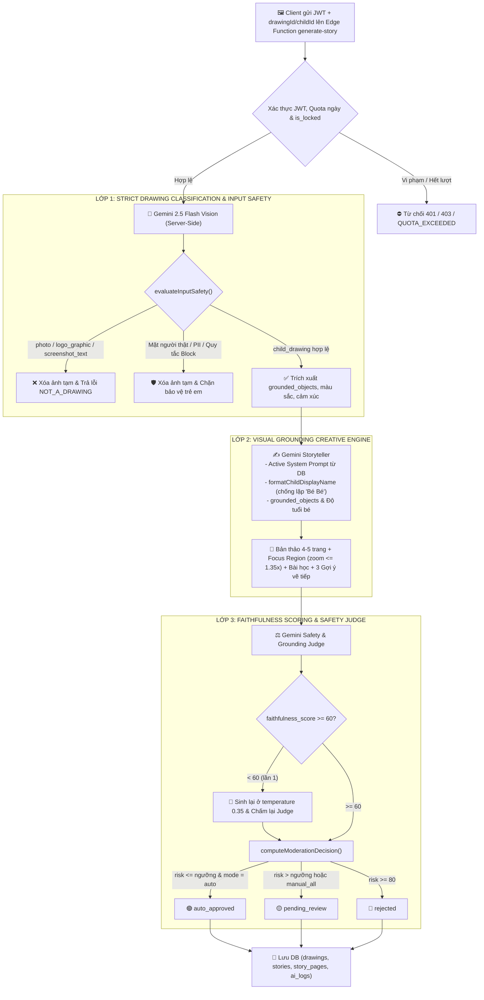

# KIẾN TRÚC PIPELINE AI & TIÊU CHUẨN RESPONSIBLE AI (02-GIAO-DIEN-AI.md)
**Dự án: DrawToStory - Hệ thống Kể Chuyện Thiếu Nhi Thông Minh từ Tranh Bé Vẽ**  
*Môn học: AI Based Programming - Trường Đại học Phú Xuân*  
*Repository:* [https://github.com/nguyendangha10126-svg/Doan-AIBD.git](https://github.com/nguyendangha10126-svg/Doan-AIBD.git)

---

## 1. KIẾN TRÚC AI SERVER-ONLY TRÊN SUPABASE EDGE FUNCTIONS

Hệ thống AI của **DrawToStory** vận hành **Pipeline xử lý 3 lớp (3-Layer Multi-Stage AI Pipeline)** sử dụng mô hình đa phương thức **Google Gemini 2.5 Flash** với đầu ra JSON có cấu trúc (`responseMimeType: "application/json"` + `responseSchema`).

### Nguyên tắc Bảo mật Cốt lõi (Zero Client Key Exposure)
1. **Cô lập khóa API 100% ở phía máy chủ**: Khóa `GEMINI_API_KEY` chỉ được lưu trong **Supabase Secrets** và chỉ được đọc bởi các hàm Deno Edge Functions (`supabase/functions/_shared/gemini.ts`) thông qua `Deno.env.get('GEMINI_API_KEY')`, gửi tới Google bằng HTTP header `x-goog-api-key` (không đính kèm khóa trên query string URL để tránh lộ trong access logs).
2. **Không gọi Gemini trực tiếp từ trình duyệt & Không dùng dữ liệu giả trên Production**:
   - Trình duyệt chỉ gửi JWT phiên đăng nhập và tham số nghiệp vụ lên `/functions/v1/generate-story` và `/functions/v1/admin-test-prompt`.
   - Nếu Edge Function chưa được triển khai hoặc thiếu `GEMINI_API_KEY` trên máy chủ, hệ thống trả về thông báo lỗi minh bạch (`MISSING_AI_KEY` / `EDGE_FUNCTION_NOT_DEPLOYED`) kèm hướng dẫn lệnh CLI cho Quản trị viên — tuyệt đối không trả về truyện mẫu cố định hay số liệu token giả mạo trên bản Production.



---

## 2. CHI TIẾT CÁC LỚP XỬ LÝ & CHUẨN HÓA NGÔN NGỮ

### 2.1. Lớp 1 — Phân loại Tranh vẽ Đa phương thức & An toàn Đầu vào
- Trích xuất cấu trúc thị giác: `is_drawing`, `image_type` (`child_drawing | artwork | logo_graphic | photo | screenshot_text | other`), `confidence`, `contains_real_person_face`, `pii_detected`, `objects`, `colors`, `mood`.
- Khi `strict_drawing_check = true` (mặc định bật): mọi ảnh chụp người thật, phong cảnh, logo thương hiệu, ảnh chụp màn hình văn bản hoặc ảnh có độ tin cậy thấp đều bị chặn ngay từ Lớp 1 với mã `NOT_A_DRAWING` và tự động dọn dẹp tệp tạm trên Storage.

### 2.2. Lớp 2 — Sáng tác Bám sát Nét vẽ & Chống Lặp Tiền Tố Tên Bé
- **Chuẩn hóa tên bé (`stripChildPrefix` & `formatChildName`)**: Nếu phụ huynh nhập biệt danh là `"Bé Hà"` hoặc `"bé Bơ"`, hệ thống tự động tách tiền tố trùng lặp khi lưu trữ và chuẩn hóa qua hàm `formatChildDisplayName` trước khi đưa vào Prompt AI cũng như toàn bộ giao diện đọc truyện, loại bỏ hoàn toàn lỗi lặp câu chữ `"Bé Bé Hà"`.
- **Visual Grounding**: Từng trang truyện bắt buộc lồng ghép các chi tiết thực tế bé đã vẽ trong `grounded_objects`; tọa độ camera `focus_region` được kẹp trong vùng an toàn ($x, y \in [20, 80]$, $\text{zoom} \le 1.35$) để hiệu ứng Ken Burns không cắt mất nét vẽ của bé.

### 2.3. Lớp 3 — Chấm Điểm Độ Bám Tranh, Tự Động Thử Lại & Định Tuyến Kiểm Duyệt
- Đánh giá độc lập hai chỉ số: `faithfulness_score` (0–100) và `risk_score` (0–100).
- Nếu `faithfulness_score < 60`, Edge Function tự động yêu cầu sinh lại ở `temperature = 0.35` và gọi lại Judge lần thứ hai trên bản thảo mới.
- Ghi nhận chính xác tổng `tokens_input`, `tokens_output`, `latency_ms` và `cost_usd` thực tế từ `usageMetadata` của Gemini API vào bảng `public.ai_logs`.

### 2.4. Phòng Thí Nghiệm System Prompt (`admin-test-prompt`)
- Tại `/admin/prompts`, khi Quản trị viên nhấn chạy thử nghiệm Prompt, ứng dụng gọi trực tiếp Edge Function `supabase/functions/admin-test-prompt/index.ts`.
- Edge Function xác thực quyền `role === 'admin'` từ JWT, thực thi lời gọi thật tới Gemini 2.5 Flash bằng khóa bí mật trên máy chủ, ghi nhận chi phí vào `ai_logs` và trả kết quả JSON thực tế về giao diện.

---

## 3. KIỂM THỬ TỰ ĐỘNG TRỰC TIẾP TRÊN MÃ NGUỒN THẬT (`scripts/test-pipeline.js`)

Khác với cách sao chép lại biểu thức điều kiện trong tệp test, kịch bản `scripts/test-pipeline.js` **import trực tiếp các hàm nghiệp vụ thật** từ `src/features/ai/utils/pipelineRules.js` (`evaluateInputSafety`, `computeModerationDecision`, `stripChildPrefix`, `formatChildName`):
1. Kiểm thử toàn bộ **6 fixtures** chuẩn trong `tests/fixtures/` (`01_real_child_drawing` PASS; `02_logo_unipat`, `03_photo_person`, `04_screenshot_text`, `05_blurry_image`, `06_dark_image` REJECT `NOT_A_DRAWING`).
2. Kiểm thử công tắc `strict_drawing_check = false` và chặn cứng khuôn mặt thật (`REAL_FACE_DETECTED`) / thông tin cá nhân (`PII_DETECTED`) bất kể chế độ kiểm tra.
3. Kiểm thử quyết định định tuyến Lớp 3 (`auto_approved`, `pending_review`, `rejected`, `manual_all`) và bộ chuẩn hóa tên bé chống lỗi `"Bé Bé Hà"`.

Chạy kiểm định bằng lệnh:
```bash
npm run test:pipeline
```

---

## 4. GIỌNG ĐỌC TIẾNG VIỆT & BỘ TỔNG HỢP ÂM THANH WEB AUDIO API (`src/lib/sound.ts`)
1. **Giọng đọc Tiếng Việt Tự nhiên (`window.speechSynthesis`)**: Tự động ưu tiên giọng đọc `vi-VN` chất lượng cao (*Microsoft Hoài My*, *Microsoft Nam Minh*, *Google Tiếng Việt*, *Apple Linh*), hỗ trợ tốc độ `0.8x`, `1.0x`, `1.2x` và highlight chữ Karaoke theo từng câu.
2. **Hiệu ứng Âm thanh & Hộp nhạc Ru ngủ không cần tệp ngoài**:
   - `playPageTurn()`: Mô phỏng tiếng lật trang giấy bằng Bandpass Filtered Noise.
   - `playSparkle()`, `playMagic()`, `playSuccess()`: Hợp âm chuông ngũ cung chúc mừng bé.
   - `startLullaby()` / `stopLullaby()`: Hộp nhạc ru ngủ giai điệu ngũ cung êm dịu kết hợp bộ hẹn giờ tự tắt 15/30/45 phút.
