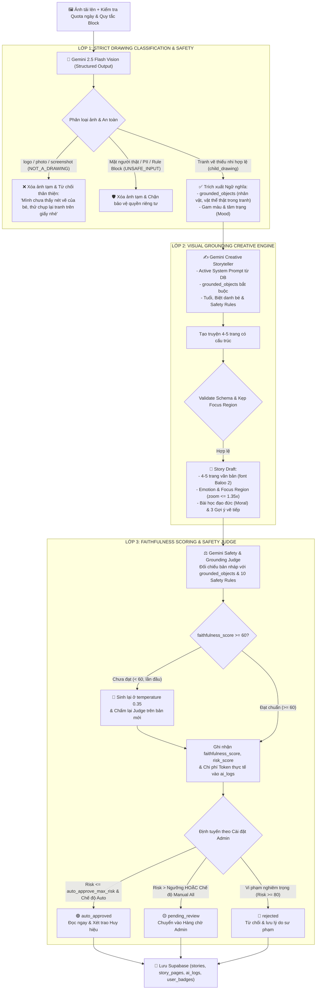

# KIẾN TRÚC PIPELINE AI & TIÊU CHUẨN RESPONSIBLE AI (02-GIAO-DIEN-AI.md)
**Dự án: DrawToStory - Hệ thống Kể Chuyện Thiếu Nhi Thông Minh từ Tranh Bé Vẽ**  
*Môn học: AI Based Programming - Trường Đại học Phú Xuân*  
*Repository:* [https://github.com/nguyendangha10126-svg/Doan-AIBD.git](https://github.com/nguyendangha10126-svg/Doan-AIBD.git)

---

## 1. TỔNG QUAN KIẾN TRÚC PIPELINE AI 3 LỚP THẬT KÉP (DUAL-PATH RESPONSIBLE AI)

Hệ thống AI của **DrawToStory** vận hành một **Pipeline xử lý đa tầng (3-Layer Multi-Stage AI Pipeline)** sử dụng mô hình đa phương thức **Google Gemini 2.5 Flash** với đầu ra JSON có cấu trúc (`responseMimeType: "application/json"` + `responseSchema`).

Để đảm bảo hệ thống luôn chạy AI thật 100% (tuyệt đối không sinh truyện mẫu "cầu vồng" giả trong chế độ Live), `StoryGenerationService` hỗ trợ **Kiến trúc Thực thi Kép (Dual-Path Execution)**:
1. **Luồng Serverless (Supabase Edge Functions)**: Gọi hàm `supabase/functions/generate-story/index.ts` trên Deno Runtime khi dự án đã cấu hình secret `GEMINI_API_KEY`.
2. **Luồng Trực tiếp (Direct 3-Layer Gemini Engine)**: Khi chưa deploy Edge Function hoặc cần kiểm thử tức thì, hệ thống tự động sử dụng khóa Gemini lưu trong `app_settings.gemini_api_key` (cấu hình trực tiếp tại `/admin/settings`) hoặc `VITE_GEMINI_API_KEY` trong `.env` để thực thi trọn vẹn cả 3 lớp Gemini 2.5 Flash, kiểm tra hạn mức ngày, áp dụng quy tắc an toàn động, lưu nhật ký token/chi phí vào `ai_logs` và trao huy hiệu tự động.

Mô hình AI đóng vai trò **trung tâm cốt lõi (Core Engine)**:
- **Layer 1 — Phân loại tranh vẽ đa phương thức & An toàn đầu vào**: Nhận diện chính xác thể thức ảnh (`child_drawing`, `artwork`, `photo`, `logo_graphic`, `screenshot_text`, `other`), độ tin cậy `confidence`, kiểm tra khuôn mặt người thật, PII và đối chiếu bộ quy tắc `safety_rules` đang bật. Nếu không phải tranh vẽ trẻ em khi bật chế độ nghiêm ngặt, trả về mã lỗi thân thiện `NOT_A_DRAWING` và dọn ảnh tạm trên Storage.
- **Layer 2 — Sáng tác bám sát nét vẽ (Visual Grounding Engine)**: Nạp phiên bản `SystemPrompt` đang kích hoạt (`is_active = true`), bắt buộc truyện phải xoay quanh các vật thể thực tế bé đã vẽ (`grounded_objects`), chỉ định cảm xúc và tọa độ camera Ken Burns kẹp an toàn (`focus_region`).
- **Layer 3 — Chấm điểm trung thực & Thẩm định an toàn độc lập (Judge & Faithfulness Retry)**: Tính toán `faithfulness_score` (0–100) đối chiếu truyện với nét vẽ. Nếu điểm dưới 60, hệ thống tự động sinh lại bản nháp ở `temperature = 0.35` và **chạy lại bộ chấm điểm Judge trên bản nháp mới** trước khi quyết định định tuyến trạng thái theo `moderation_mode` và `auto_approve_max_risk`.



---

## 2. CHI TIẾT CÁC LỚP TRONG PIPELINE & PHÒNG THÍ NGHIỆM PROMPT

### 2.1. LỚP 1: PHÂN LOẠI TRANH VẼ ĐA PHƯƠNG THỨC (STRICT DRAWING CLASSIFICATION)
- **Cơ chế**: Gemini Vision phân tích dữ liệu ảnh Base64/Storage và trả về JSON có cấu trúc:
  - `is_drawing`: `boolean`
  - `image_type`: enum `child_drawing | artwork | logo_graphic | photo | screenshot_text | other`
  - `confidence`: số thực từ `0.0` đến `1.0`
  - `contains_real_person_face`: `boolean`
  - `pii_detected`: `boolean`
  - `objects`, `colors`, `mood`, `characters`: danh sách đặc trưng thị giác trích xuất trực tiếp từ nét vẽ.
- **Quy tắc chặn nghiêm ngặt (`strict_drawing_check`)**:
  - Khi `strict_drawing_check = true`: nếu `image_type` thuộc `{ 'logo_graphic', 'photo', 'screenshot_text', 'other' }` hoặc `!is_drawing`, pipeline trả về mã lỗi `NOT_A_DRAWING` kèm lời nhắn nhẹ nhàng hướng dẫn cha mẹ chụp lại tranh vẽ trên giấy.
  - Quản trị viên có thể bật/tắt công tắc `strict_drawing_check` tức thì tại `/admin/settings`.

### 2.2. LỚP 2: SÁNG TÁC BÁM SÁT NÉT VẼ (STRICT VISUAL GROUNDING)
- **Cơ chế**: Truyền danh sách `grounded_objects` từ Lớp 1 cùng nội dung `SystemPrompt` đang hoạt động và các quy tắc `rewrite`/`flag` từ `safety_rules` vào ngữ cảnh tạo truyện.
- **Ràng buộc**:
  - Từng trang truyện bắt buộc phải nhắc tới ít nhất một nhân vật/chi tiết thực sự có trong tranh của bé.
  - Không bịa thêm sinh vật lạ không liên quan khi tranh chỉ vẽ các đối tượng cụ thể.
  - Tọa độ `focus_region` `{x, y, zoom}` được kẹp an toàn ($x, y \in [20, 80]$, $\text{zoom} \le 1.35$) để hiệu ứng Ken Burns mượt mà mà không bao giờ cắt mất nét vẽ ở rìa tranh (`object-fit: contain`).

### 2.3. LỚP 3: CHẤM ĐIỂM TRUNG THỰC, RETRY CHUẨN XÁC & THẨM ĐỊNH AN TOÀN
- **Faithfulness Scoring**: Đánh giá mức độ trung thực giữa văn bản truyện và `grounded_objects` (thang điểm 0–100, lưu vào `stories.faithfulness_score`).
- **Cơ chế Thử lại & Chấm lại (Regenerate & Re-Judge)**: Nếu `faithfulness_score < 60`, Lớp 2 tự động sinh lại câu chuyện với `temperature = 0.35` kèm chỉ dẫn bám sát vật thể khắt khe hơn, sau đó Lớp 3 gọi lại `buildJudgePrompt` trên chính bản thảo vừa sinh lại để cập nhật chính xác `faithfulness_score` và `risk_score`.
- **Ghi nhận Chi phí & Hiệu năng thật (`ai_logs`)**: Tổng hợp chính xác `tokens_input`, `tokens_output`, `latency_ms` và `cost_usd` từ `usageMetadata` của Gemini API qua cả 3 lớp.

### 2.4. PHÒNG THÍ NGHIỆM SYSTEM PROMPT THỜI GIAN THỰC (`runPromptPlayground`)
Tại trang `/admin/prompts`, Quản trị viên có thể chỉnh sửa nội dung System Prompt và bấm **Chạy thử nghiệm**:
- Hệ thống gọi trực tiếp Gemini 2.5 Flash (qua Edge Function `admin-test-prompt` hoặc Direct Gemini Engine) với kịch bản tranh vẽ thử nghiệm.
- Hiển thị ngay câu chuyện JSON sinh ra, số lượng token đầu vào/đầu ra, độ trễ phản hồi (`ms`) và chi phí ước tính (`USD`), đồng thời ghi log vào `ai_logs` để theo dõi ngân sách tập trung.

---

## 3. BỘ KIỂM THỬ FIXTURES TỰ ĐỘNG (PIPELINE TEST FIXTURES)

Hệ thống cung cấp kịch bản kiểm thử tự động tại `scripts/test-pipeline.js` thực thi trên 6 fixtures chuẩn hóa trong thư mục `tests/fixtures/`:
- `01_real_child_drawing.json`: Tranh vẽ tay hoa & cầu vồng $\rightarrow$ **PASS** (`child_drawing`).
- `02_logo_unipat.json`: Logo đồ họa Unipat $\rightarrow$ **REJECT** (`NOT_A_DRAWING`).
- `03_photo_person.json`: Ảnh chụp mặt người lớn $\rightarrow$ **REJECT** (`NOT_A_DRAWING`).
- `04_screenshot_text.json`: Ảnh chụp màn hình đoạn văn $\rightarrow$ **REJECT** (`NOT_A_DRAWING`).
- `05_blurry_image.json`: Ảnh rung lắc mờ $\rightarrow$ **REJECT** (`NOT_A_DRAWING`).
- `06_dark_image.json`: Ảnh tối thiếu sáng $\rightarrow$ **REJECT** (`NOT_A_DRAWING`).

Chạy kiểm thử bất kỳ lúc nào bằng lệnh:
```bash
npm run test:pipeline
```
Kịch bản đồng thời kiểm tra tính đúng đắn của công tắc `strict_drawing_check` (`true`: chặn nghiêm ngặt; `false`: cho phép ở chế độ demo).

---

## 4. GIỌNG ĐỌC TIẾNG VIỆT & BỘ TỔNG HỢP ÂM THANH SƯ PHẠM (AUDIO, TTS & LULLABY ENGINE)
1. **Bộ tổng hợp giọng đọc Tiếng Việt (Neural Vietnamese TTS)**:
   - Tự động quét và ưu tiên các giọng đọc tiếng Việt (`vi-VN`) tự nhiên trên thiết bị: *Microsoft Hoài My (Nữ)*, *Microsoft Nam Minh (Nam)*, *Google Tiếng Việt*, *Apple Linh*.
   - Hỗ trợ đổi giọng trực tiếp ngay trên thanh điều khiển đọc sách (cả trang đọc chính lẫn trang chia sẻ `/shared/:token`) và điều chỉnh tốc độ kể chuyện `0.8x` (ru ngủ), `1.0x` (tiêu chuẩn), `1.2x` (sôi nổi).
   - Tự động tách câu theo dấu ngắt và highlight chữ Karaoke đồng bộ với tiến trình đọc của từng trang.
2. **Bộ tạo hiệu ứng âm thanh & Nhạc hộp Ru ngủ thời gian thực (`src/lib/sound.ts`)**:
   - Tổng hợp trực tiếp bằng Web Audio API (`OscillatorNode`, `GainNode`, `BiquadFilterNode`), không phụ thuộc tệp âm thanh ngoài:
     - `playPageTurn()`: Âm thanh lật giấy sách chân thực bằng tiếng ồn qua bộ lọc thông dải (Bandpass sweep).
     - `playSparkle()` / `playMagic()` / `playSuccess()`: Hợp âm ngũ cung lung linh khi hóa phép tạo truyện hoặc hoàn thành đọc sách.
     - `startLullaby()` / `stopLullaby()`: Bộ tổng hợp nhạc hộp ru ngủ êm dịu phát vòng lặp giai điệu ngũ cung (`C5–E5–G5–B5–A5`) ở âm lượng nhẹ nhàng, tự động dọn dẹp bộ hẹn giờ khi rời trang hoặc hết giờ hẹn ngủ.
     - `playTap()` / `playLock()`: Phản hồi âm thanh xúc giác trong Chế độ bé và Cổng bảo vệ phụ huynh.
