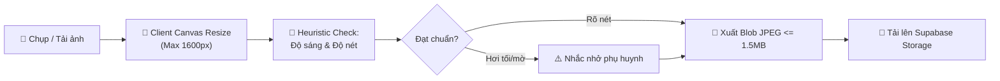

# BÁO CÁO KỸ THUẬT FRONTEND & TRẢI NGHIỆM NGƯỜI DÙNG (03-KY-THUAT-FRONTEND.md)
**Dự án: DrawToStory - Hệ thống Kể Chuyện Thiếu Nhi Thông Minh từ Tranh Bé Vẽ**  
*Môn học: AI Based Programming - Trường Đại học Phú Xuân*

---

## 1. TỔNG QUAN KIẾN TRÚC FRONTEND

Hệ thống Frontend của **DrawToStory** được xây dựng theo chuẩn Single Page Application (SPA) hiện đại, đề cao tính module hóa, tối ưu hiệu năng và an toàn mã nguồn với cấu hình **TypeScript Strict Mode (`noImplicitAny`, `strictNullChecks`, `noUnusedLocals`)**.

### Cây Thư Mục Cấu Trúc Mã Nguồn (`src/`)
```
src/
├── app/                      # Cấu hình ứng dụng cốt lõi
│   ├── App.tsx               # Root component bọc Provider & Error Boundary
│   ├── guards.tsx            # Route Guards bảo vệ phân quyền (AuthGuard, RoleGuard)
│   └── router.tsx            # Khai báo React Router v6 với Lazy Loading
├── assets/                   # Tài nguyên tĩnh (Logo SVG, icons, illustrations)
├── components/               # Thiết kế hệ thống UI dùng chung (Design System Primitives)
│   ├── layout/               # Header, BottomNav, AdminSidebar, AuthLayout
│   ├── feedback/             # ErrorBoundary, SkeletonLoader, EmptyState
│   └── ui/                   # Button, Card, Badge, Modal, Input, Textarea, GlassPanel
├── features/                 # Các Module Nghiệp Vụ Chức Năng (Feature-based Architecture)
│   ├── admin/                # Trang quản trị: Overview, Moderation, Rules, Prompts, Costs, Users
│   ├── ai/                   # AI Service, Pipeline Progress Indicator, Canvas Compression
│   ├── auth/                 # Trang đăng nhập, đăng ký, quên mật khẩu
│   ├── reader/               # Trình đọc sách 3D (PageFlip / Swipe), TTS, Ken Burns, Bedtime Mode
│   ├── story/                # Wizard tạo truyện 3 bước, Thư viện truyện, Chia sẻ truyện
│   └── user/                 # Dashboard phụ huynh, Cài đặt hồ sơ, Quản lý bé, Chế độ Kid Mode
├── hooks/                    # Custom Hooks (useSpeechSynthesis, useMediaQuery, useParentalGate)
├── lib/                      # Thư viện tiện ích, cấu hình Supabase Client, i18n
│   ├── i18n/vi.ts            # Từ điển ngôn ngữ tiếng Việt tập trung 100%
│   ├── supabase.ts           # Supabase JS Client khởi tạo với Auth Session Persist
│   └── utils.ts              # Hàm tiện ích cn (clsx + tailwind-merge), format ngày tháng
├── stores/                   # Quản lý Trạng Thái Toàn Cục (Zustand Stores)
│   ├── useAdminStore.ts      # Quản lý dữ liệu Admin, Moderation Queue, Rules, Prompts
│   ├── useAuthStore.ts       # Quản lý Phiên Đăng Nhập, Role, Profile, Children List
│   ├── useStoryStore.ts      # Quản lý Danh sách truyện, Trạng thái đang đọc, Bộ lọc
│   └── useUiStore.ts         # Quản lý Dark/Bedtime Mode, Toast Notification, Active Child
└── types/                    # Định nghĩa kiểu dữ liệu TypeScript (database.ts, index.ts)
```

---

## 2. QUẢN LÝ TRẠNG THÁI TOÀN CỤC (STATE MANAGEMENT)

Ứng dụng sử dụng **Zustand** thay vì Redux Toolkit nhằm giảm boilerplate, tối ưu bundle size và hỗ trợ Re-render có chọn lọc (selective selector):
- **`useAuthStore`**: Lưu trữ `user`, `profile`, `children`, `token`. Tự động đồng bộ với Supabase Auth Event (`SIGNED_IN`, `SIGNED_OUT`, `TOKEN_REFRESHED`). Tích hợp cơ chế fallback demo offline linh hoạt cho phép giảng viên nghiệm thu ngay cả khi không có kết nối Supabase Cloud.
- **`useStoryStore`**: Quản lý danh sách truyện tranh của bé, truyện đang được kích hoạt đọc (`currentStory`), bộ lọc theo trạng thái (`auto_approved`, `pending_review`...).
- **`useAdminStore`**: Lưu trữ dữ liệu điều hành: hàng đợi kiểm duyệt, danh sách quy tắc an toàn, danh sách prompt hệ thống, số liệu thống kê chi phí và token.
- **`useUiStore`**: Điều khiển thanh điều hướng, chế độ ru ngủ (`bedtimeMode`), kích thước chữ và âm lượng đọc sách.

---

## 3. DESIGN SYSTEM & KHẢ NĂNG TIẾP CẬN (ACCESSIBILITY)

### 3.1. Bảng Màu & Typography (Tokens trong `tailwind.config.js`)
Được thiết kế dựa trên phong cách **sách tranh thiếu nhi pastel ấm áp**, tạo cảm giác dịu mắt, an tâm cho cả phụ huynh và trẻ nhỏ:
- `cream` (`#FFF9F0`): Màu nền chủ đạo ấm cúng, giảm mỏi mắt so với nền trắng tinh khiết.
- `peach` (`#FFD6BA`): Màu nhấn phụ cho các nút tương tác nhẹ nhàng.
- `mint` (`#C9F0DD`): Tượng trưng cho sự an toàn, trạng thái đã phê duyệt.
- `sky` (`#CDE7FF`): Tượng trưng cho bầu trời sáng tạo và trí tưởng tượng.
- `lavender` (`#E3D9FF`): Tông màu thư giãn cho Chế độ Ru ngủ.
- `butter` (`#FFF1B8`): Tông màu ấm áp cho các gợi ý vẽ tranh tiếp theo.
- `primary` (`#FF8FA3`): Màu hồng san hô thân thiện, nút hành động chính (CTA).
- `accent` (`#7C6CF0`): Màu tím ma thuật đại diện cho phép màu AI.
- `text` (`#4A3F55`): Màu chữ tím than đậm, độ tương phản đạt chuẩn **WCAG AA (tỉ lệ tương phản $\ge 4.5:1$)**.
- Font chữ: **`Quicksand`** cho tiêu đề tròn trịa đáng yêu và **`Nunito`** cho văn bản truyện rõ ràng, hiển thị chuẩn 100% dấu tiếng Việt.

### 3.2. Tiêu chuẩn Mobile-First & Touch Targets
- Toàn bộ vùng chạm trên thiết bị di động (nút bấm, icon, tab chuyển) đều có kích thước tối thiểu **$44 \times 44$ pixel**.
- Điều hướng: Bottom Navigation cố định dưới đáy màn hình trên di động; thanh bên gập mở mượt mà trên desktop.
- Hỗ trợ chuẩn CSS `prefers-reduced-motion` để giảm bớt hiệu ứng chuyển động đối với trẻ nhỏ nhạy cảm thị giác.

---

## 4. CHI TIẾT CÁC TÍNH NĂNG ĐẶC SẮC (KEY USER EXPERIENCES)

### 4.1. Tiền Xử Lý Ảnh Phía Client (Client-side Image Preprocessing)
Tệp `src/features/ai/services/storyGenerationService.ts` thực hiện tiền xử lý ảnh trước khi gửi lên mạng:
- **Nén thông minh qua HTML5 Canvas**: Tự động tính toán tỉ lệ và nén ảnh xuống dung lượng $\le 1.5$ MB và kích thước tối đa 1600px. Giúp giảm 80% thời gian tải lên và tiết kiệm chi phí băng thông Storage.
- **Xoay ảnh & Xem trước tức thì**: Cho phép phụ huynh xoay ảnh đúng chiều ($90^\circ, 180^\circ, 270^\circ$).
- **Heuristic Phát Hiện Ảnh Tối / Mờ**: Phân tích biểu đồ Histogram độ sáng của các pixel trên Canvas; nếu độ sáng trung bình $< 40/255$ hoặc độ lệch chuẩn biên cạnh quá thấp, hệ thống hiển thị cảnh báo dịu dàng: *"Bức tranh hơi tối hoặc mờ, ba mẹ chụp ở nơi đủ sáng để AI nhìn rõ hơn nhé!"*.



### 4.2. Thanh Tiến Trình Hoạt Họa 4 Giai Đoạn (4-Stage Animated Loader)
Thay vì vòng quay tròn vô cảm, giao diện hiển thị hoạt họa từng bước tương ứng với pipeline thật:
1. *"Đang ngắm nhìn nét vẽ của bé..."* (Phân tích Lớp 1)
2. *"Kiểm tra an toàn nội dung..."* (Thẩm định PII & Mặt người)
3. *"Đang viết nên câu chuyện diệu kỳ..."* (Sáng tác Lớp 2)
4. *"Soát lại lần cuối cùng cô tiên kiểm duyệt..."* (Chấm điểm Lớp 3)

### 4.3. Trình Đọc Sách 3D, Hiệu Ứng Ken Burns & Web Speech TTS
- **Lật sách 3D đa nền tảng**:
  - Trên màn hình lớn ($\ge 640$px): Tích hợp `react-pageflip` mô phỏng độ cong và bóng đổ của trang sách giấy chân thực.
  - Trên màn hình nhỏ ($< 640$px): Chuyển đổi mượt mà sang trình vuốt ngang cảm ứng (horizontal swipe) sử dụng `Framer Motion` với gesture kéo thả tự nhiên.
- **Hiệu ứng Ken Burns**: Mỗi trang truyện áp dụng thuộc tính `focus_region: {x, y, zoom}` do AI tạo ra. Ảnh gốc được phóng to và trượt nhẹ vào đúng vị trí nhân vật đang được nhắc tới, biến bức tranh tĩnh thành một thước phim hoạt hình sống động.
- **Giọng đọc Web Speech API**:
  - Tự động nhận diện voice `vi-VN` của thiết bị (Google Tiếng Việt, Microsoft An...).
  - Đánh dấu từ/câu đang đọc (Sentence-level highlight) giúp bé vừa nghe vừa nhận diện mặt chữ tiếng Việt.
  - Tự động lật sang trang tiếp theo khi đọc xong trang hiện tại.
- **Chế độ Ru Ngủ (Bedtime Mode)**:
  - Giảm độ sáng giao diện xuống tông màu hổ phách/lavender dịu nhẹ.
  - Tự động giảm tốc độ giọng đọc xuống $0.85\times$.
  - Tích hợp bộ đếm giờ tắt (15 phút, 30 phút, 45 phút).

### 4.4. Chế Độ Trẻ Em (Kid Mode) & Cổng Phụ Huynh (Parental Gate)
- Giao diện Kid Mode loại bỏ toàn bộ các nút điều hướng, cấu hình và tính năng chỉnh sửa phức tạp. Bé chỉ thấy kệ sách các câu chuyện đã được duyệt an toàn.
- Để thoát khỏi chế độ Kid Mode quay lại giao diện phụ huynh, hệ thống yêu cầu giải một bài toán ngẫu nhiên (ví dụ: $7 \times 8 = ?$) hoặc nhập mã PIN phụ huynh 4 chữ số, ngăn ngừa trẻ nhỏ vô tình can thiệp vào cài đặt tài khoản.

### 4.5. Hỗ Trợ In Ấn & Xuất Bản Sách Thật (`@media print`)
Ứng dụng tích hợp bộ stylesheet in ấn chuyên dụng:
- Tự động ẩn thanh điều hướng, nút bấm âm thanh và các công cụ điều khiển.
- Phân trang chuẩn khổ A4 ngang hoặc vuông; căn chỉnh mép trang để phụ huynh có thể in ấn đóng thành tập sách tranh kỷ niệm cho con.

