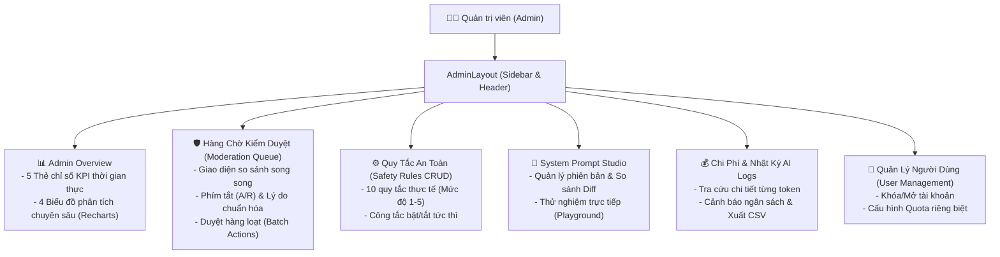

# BÁO CÁO KỸ THUẬT QUẢN TRỊ & HỆ THỐNG KIỂM DUYỆT (04-KY-THUAT-ADMIN.md)
**Dự án: DrawToStory - Hệ thống Kể Chuyện Thiếu Nhi Thông Minh từ Tranh Bé Vẽ**  
*Môn học: AI Based Programming - Trường Đại học Phú Xuân*

---

## 1. TRIẾT LÝ THIẾT KẾ: "ADMIN CÓ VAI TRÒ THỰC THỤ"

Trong hầu hết các đồ án môn học, phân hệ Quản trị viên (Admin) thường chỉ là các bảng thống kê tĩnh hoặc màn hình CRUD đơn giản. Tuy nhiên, đối với một sản phẩm ứng dụng Trí Tuệ Nhân Tạo phục vụ đối tượng đặc biệt nhạy cảm là trẻ em, **vai trò của Admin là mắt xích sống còn trong chu trình Responsible AI (Human-in-the-loop Governance)**:
1. **Kiểm duyệt nội dung (Content Moderation)**: Thẩm định các câu chuyện AI có điểm rủi ro cao hoặc hệ thống chạy ở chế độ kiểm duyệt thủ công toàn phần trước khi trẻ em tiếp cận.
2. **Quản trị quy tắc an toàn động (Safety Rules Engine)**: Bật/tắt, thêm mới hoặc điều chỉnh mức độ nghiêm ngặt của các bộ quy tắc mà không cần sửa code hay triển khai lại server.
3. **Phòng thí nghiệm Prompt (System Prompt Studio)**: Thử nghiệm, so sánh phiên bản (diff) và đo lường độ trễ của các biến thể prompt sáng tác trên tranh mẫu.
4. **Giám sát tài chính & Vận hành (Cost & Quota Observability)**: Theo dõi từng xu chi phí token của Google Gemini, phát hiện bất thường và điều tiết hạn mức sử dụng.

---

## 2. KIẾN TRÚC BẢO MẬT PHÂN QUYỀN TRÊN SUPABASE DATABASE

### 2.1. Hàm `is_admin()` Security Definer
Để ngăn chặn hoàn toàn việc người dùng can thiệp vào mã client để tự phong quyền, cơ sở dữ liệu Supabase định nghĩa hàm `is_admin()` chạy với quyền bảo mật cao nhất của Postgres:
```sql
CREATE OR REPLACE FUNCTION public.is_admin()
RETURNS BOOLEAN
LANGUAGE sql
SECURITY DEFINER
SET search_path = public
AS $$
  SELECT EXISTS (
    SELECT 1 FROM profiles
    WHERE id = auth.uid() AND role = 'admin'
  );
$$;
```

### 2.2. Cơ Chế Row Level Security (RLS) Toàn Diện
Tất cả 13 bảng trong hệ thống đều kích hoạt RLS (`ALTER TABLE ... ENABLE ROW LEVEL SECURITY`). Các nguyên tắc bất khả xâm phạm bao gồm:
- **Người dùng thông thường (User)**:
  - Chỉ được `SELECT`, `INSERT`, `UPDATE` trên các bản ghi có `user_id = auth.uid()` hoặc `parent_id = auth.uid()`.
  - **Tuyệt đối không được phép cập nhật** các cột nhạy cảm: `role` (trong `profiles`), `status`, `risk_score`, `rejection_reason` (trong `stories`).
- **Quản trị viên (Admin)**:
  - Thông qua hàm `is_admin()`, Admin có quyền đọc toàn bộ dữ liệu hệ thống.
  - Có toàn quyền cập nhật trạng thái kiểm duyệt câu chuyện, chỉnh sửa `safety_rules`, tạo phiên bản `system_prompts`, và khóa tài khoản vi phạm.

---

## 3. CÁC PHÂN HỆ QUẢN TRỊ CHI TIẾT



---

### 3.1. Hàng Chờ Kiểm Duyệt Nội Dung (Moderation Queue)
- **Giao diện So Sánh Song Song (Split Layout)**:
  - *Cột bên trái*: Hiển thị bức tranh gốc của bé, thông tin bé (biệt danh, độ tuổi), tiêu đề và nội dung từng trang truyện.
  - *Cột bên phải*: Hiển thị phân tích của AI Lớp 1 (đối tượng, tâm trạng), điểm rủi ro Lớp 3 (`risk_score`), và danh sách các quy tắc an toàn bị cảnh báo kèm lý do chi tiết.
- **Tối ưu Năng suất Thao tác (Productivity Features)**:
  - **Phím tắt bàn phím**: Bấm phím `A` để Phê duyệt nhanh (`Approve`), bấm phím `R` để Từ chối (`Reject`).
  - **Bộ lý do từ chối mẫu (Canned Reasons)**: *"Nội dung có chi tiết rùng rợn không phù hợp lứa tuổi"*, *"Hình ảnh nghi ngờ chứa thông tin cá nhân hoặc khuôn mặt người thật"*, *"Từ vựng quá phức tạp so với độ tuổi mầm non"*.
  - **Phê duyệt hàng loạt (Batch Moderation)**: Cho phép chọn nhiều câu chuyện có `risk_score` thấp để duyệt cùng một lúc.
- **Đo Lường Độ Khớp AI vs Admin (`v_ai_admin_agreement`)**: Cơ sở dữ liệu theo dõi tỷ lệ đồng thuận giữa quyết định của AI Judge và quyết định của Admin người thật để đánh giá chất lượng mô hình.

---

### 3.2. Quản Trị Bộ Quy Tắc An Toàn (Safety Rules Engine)
Hệ thống tích hợp sẵn 10 quy tắc an toàn thực tế dành cho trẻ em:
1. `VIOLENCE_PHYSICAL`: Chặn mọi hành vi bạo lực thể xác, đánh đập, vũ khí (Mức độ 5 - Action: `block`).
2. `REAL_FACE_DETECTED`: Không xử lý ảnh có mặt người thật (Mức độ 5 - Action: `block`).
3. `PII_LEAKAGE`: Phát hiện số điện thoại, tên trường học, địa chỉ nhà (Mức độ 5 - Action: `block`).
4. `FEAR_NIGHTMARE`: Hạn chế bóng ma, quái vật kinh dị, chi tiết gây ác mộng (Mức độ 4 - Action: `rewrite`).
5. `DISCRIMINATION`: Chặn phân biệt đối xử về ngoại hình, giới tính, gia cảnh (Mức độ 5 - Action: `block`).
6. `DANGEROUS_ACTIONS`: Ngăn chặn trẻ bắt chước nghịch lửa, trèo cao, uống thuốc (Mức độ 5 - Action: `block`).
7. `ADULT_THEMES`: Cấm tuyệt đối ngôn từ người lớn, tình cảm lãng mạn không phù hợp (Mức độ 5 - Action: `block`).
8. `NEGATIVE_SELF_IMAGE`: Chống ngôn từ tự ti, coi thường bản thân của trẻ (Mức độ 3 - Action: `rewrite`).
9. `COMMERCIAL_PROMOTION`: Không quảng bá thương hiệu, mua sắm đồ chơi thương mại (Mức độ 2 - Action: `flag`).
10. `AGE_INAPPROPRIATE_LANG`: Đảm bảo độ dài câu và từ vựng đúng chuẩn lứa tuổi (Mức độ 3 - Action: `rewrite`).

Mỗi quy tắc có thể được Admin bật hoặc tắt tức thì (`is_active`). Các quy tắc đang bật sẽ được tự động đưa vào prompt của Pipeline Lớp 2 và Lớp 3.

---

### 3.3. Phòng Thí Nghiệm Prompt (System Prompt Studio & Playground)
- **Quản lý phiên bản**: Mỗi lần cập nhật cấu trúc prompt, hệ thống lưu thành một phiên bản mới (v1.0.0, v1.1.0...). Ràng buộc cơ sở dữ liệu bảo đảm **duy nhất 1 phiên bản có `is_active = true`** tại một thời điểm.
- **Trình so sánh Diff trực quan**: Cho phép Admin xem rõ sự thay đổi giữa phiên bản dự thảo và phiên bản hiện tại trước khi kích hoạt.
- **Interactive Playground**: Admin có thể chọn một bức tranh mẫu từ thư viện, nhấn *"Thử nghiệm Prompt"* để gọi Edge Function `admin-test-prompt`. Màn hình hiển thị ngay lập tức văn bản truyện được tạo ra, số token tiêu thụ và độ trễ mili-giây mà không làm ảnh hưởng đến dữ liệu của người dùng thật.

---

### 3.4. Giám Sát Chi Phí & Nhật Ký Vận Hành AI (`CostsQuotasPage`)
- **Bảng Tra Cứu Nhật Ký `ai_logs`**:
  - Ghi nhận chi tiết: Mã người dùng, ID câu chuyện, Hành động (`vision_analysis`, `story_generation`, `safety_judge`), Số Token Đầu Vào, Số Token Đầu Ra, Độ trễ (ms), Chi phí ước tính (USD), Mã lỗi.
  - Hỗ trợ tìm kiếm theo ID và lọc theo khoảng thời gian.
- **Cảnh báo Ngân sách Tháng**: Thanh hiển thị phần trăm ngân sách chi tiêu thực tế so với hạn mức tháng (ví dụ: cảnh báo màu vàng khi đạt 80%, màu đỏ khi đạt 95%).
- **Xuất Dữ Liệu CSV**: Cho phép trích xuất toàn bộ nhật ký tiêu thụ để phục vụ báo cáo tài chính hoặc nghiên cứu học thuật.
- **Quản lý Hạn Mức**: Cài đặt giới hạn số lượt tạo truyện mỗi ngày cho toàn bộ người dùng hoặc ghi đè riêng cho từng phụ huynh.

---

### 3.5. Hệ Thống Views Báo Cáo Phân Tích (Database Analytics Views)
Cơ sở dữ liệu được tối ưu hóa với 3 Views phục vụ riêng cho Dashboard:
1. `v_daily_stats`: Tổng hợp số câu chuyện tạo ra mỗi ngày theo từng trạng thái (`approved`, `rejected`, `pending`).
2. `v_cost_by_day`: Tổng hợp lượng Token và tổng chi phí USD tiêu tốn mỗi ngày trong 30 ngày gần nhất.
3. `v_ai_admin_agreement`: Đo lường phần trăm đồng thuận giữa AI Lớp 3 và Quyết định của Quản trị viên trong bảng `moderation_reviews`.

